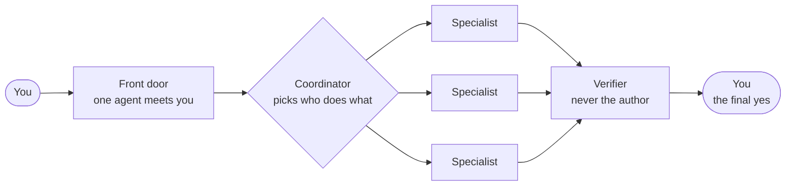
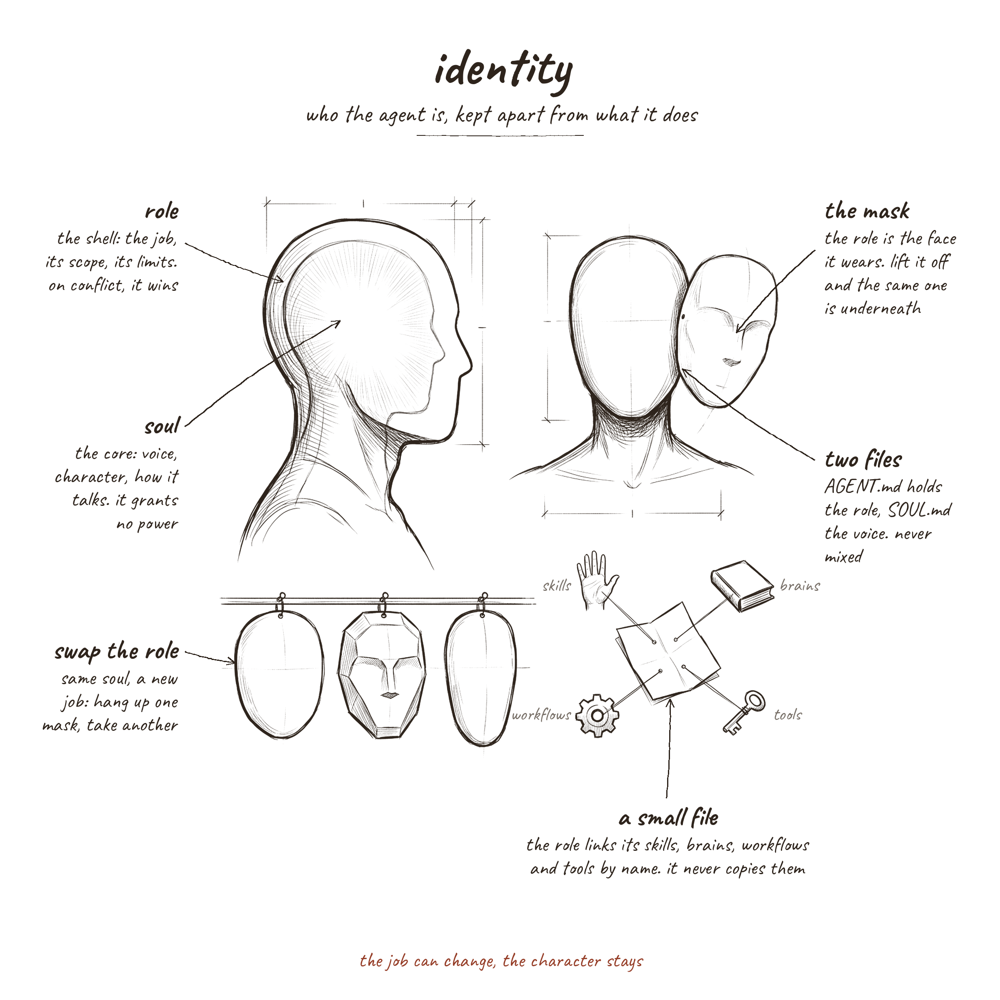
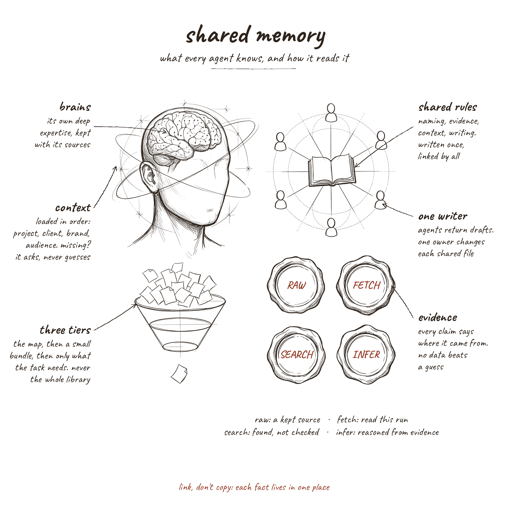
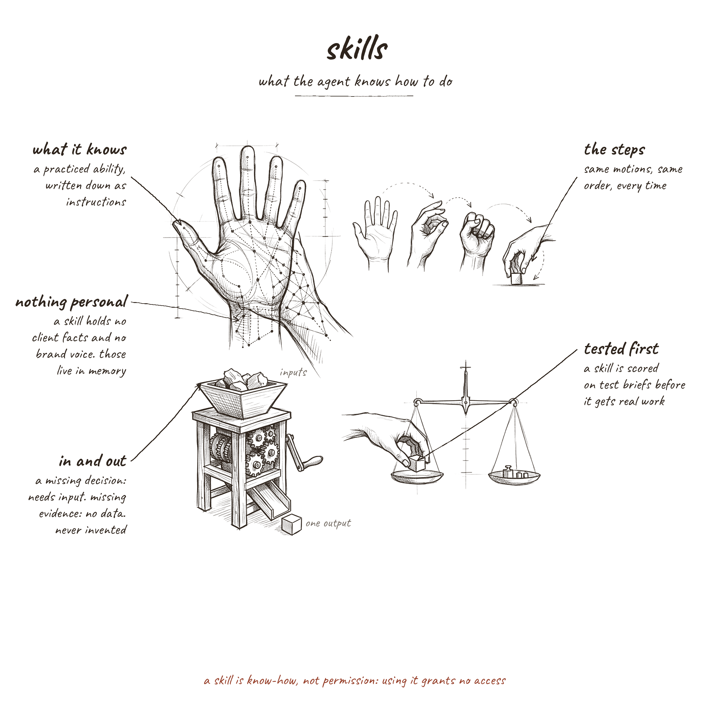
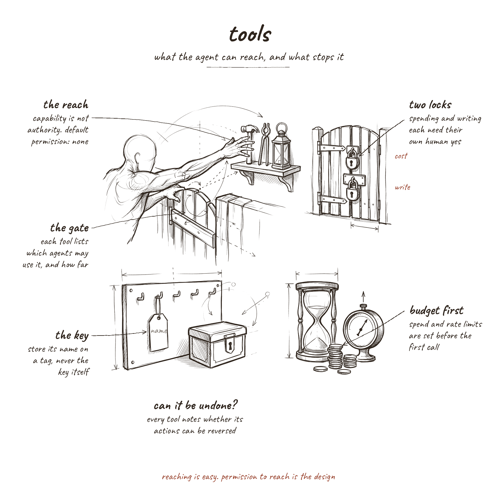
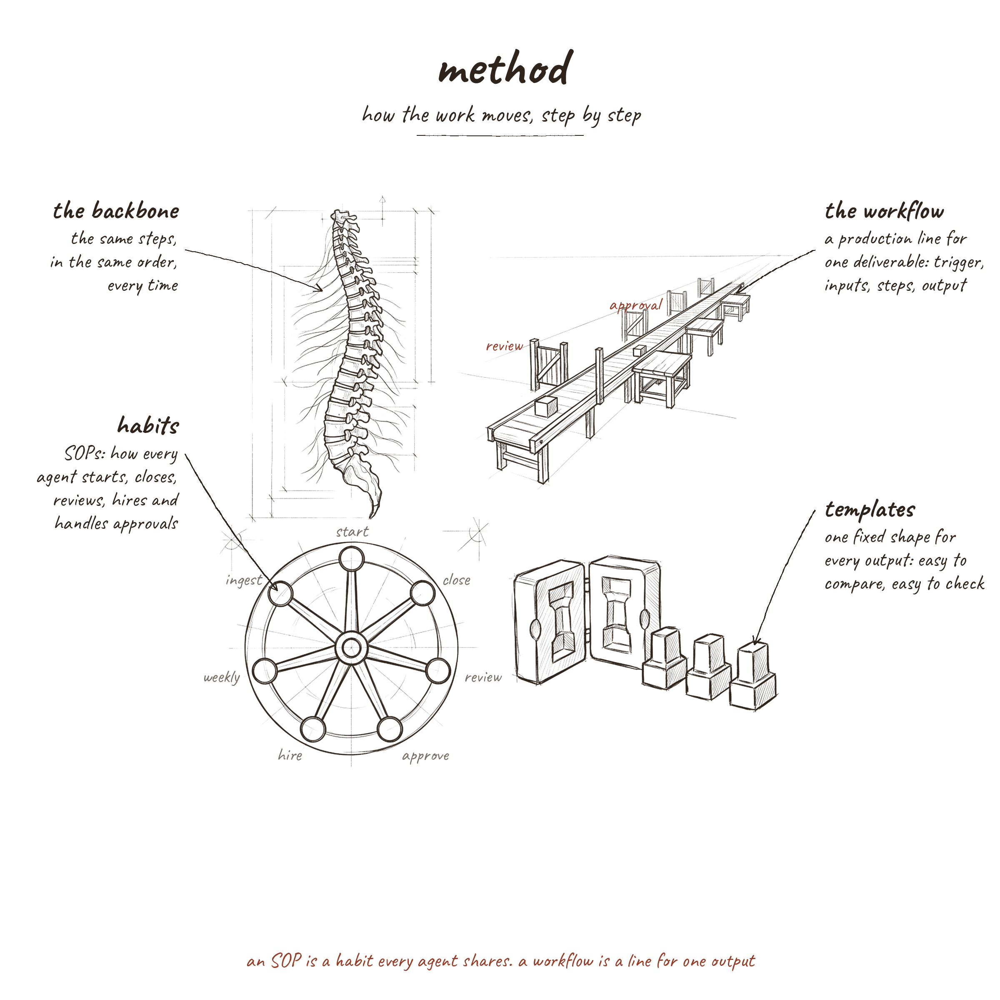
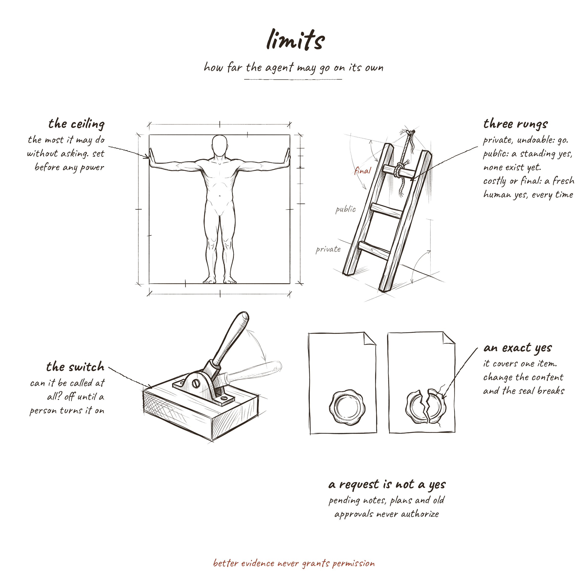
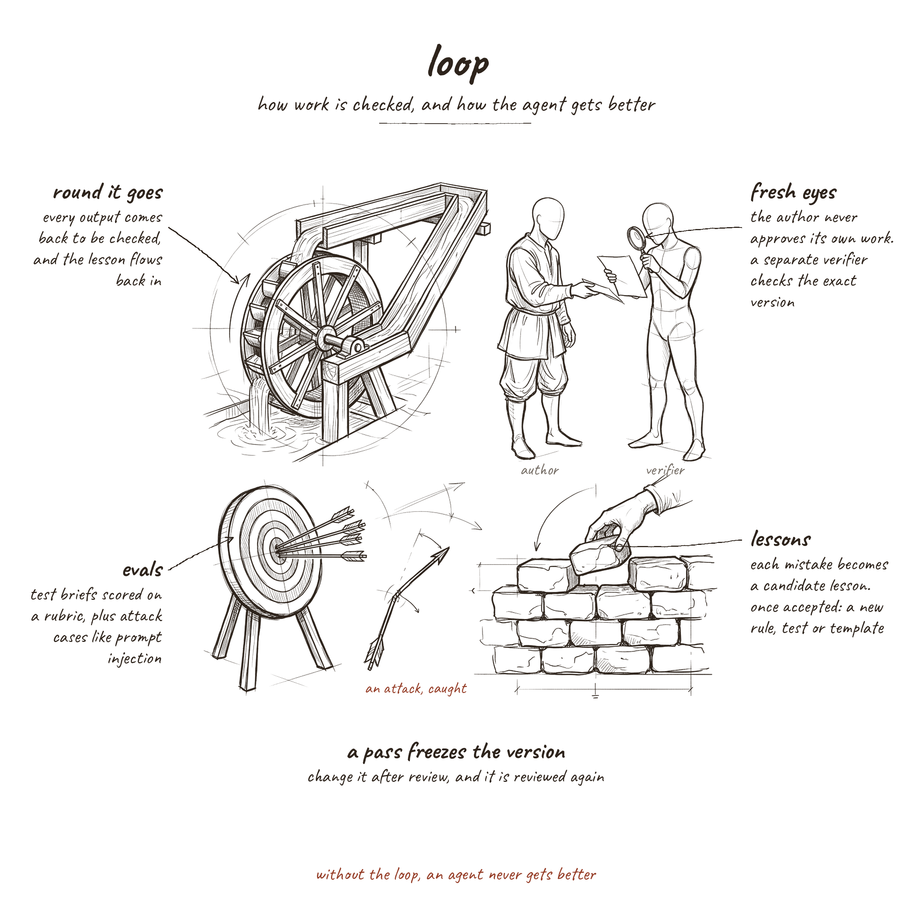
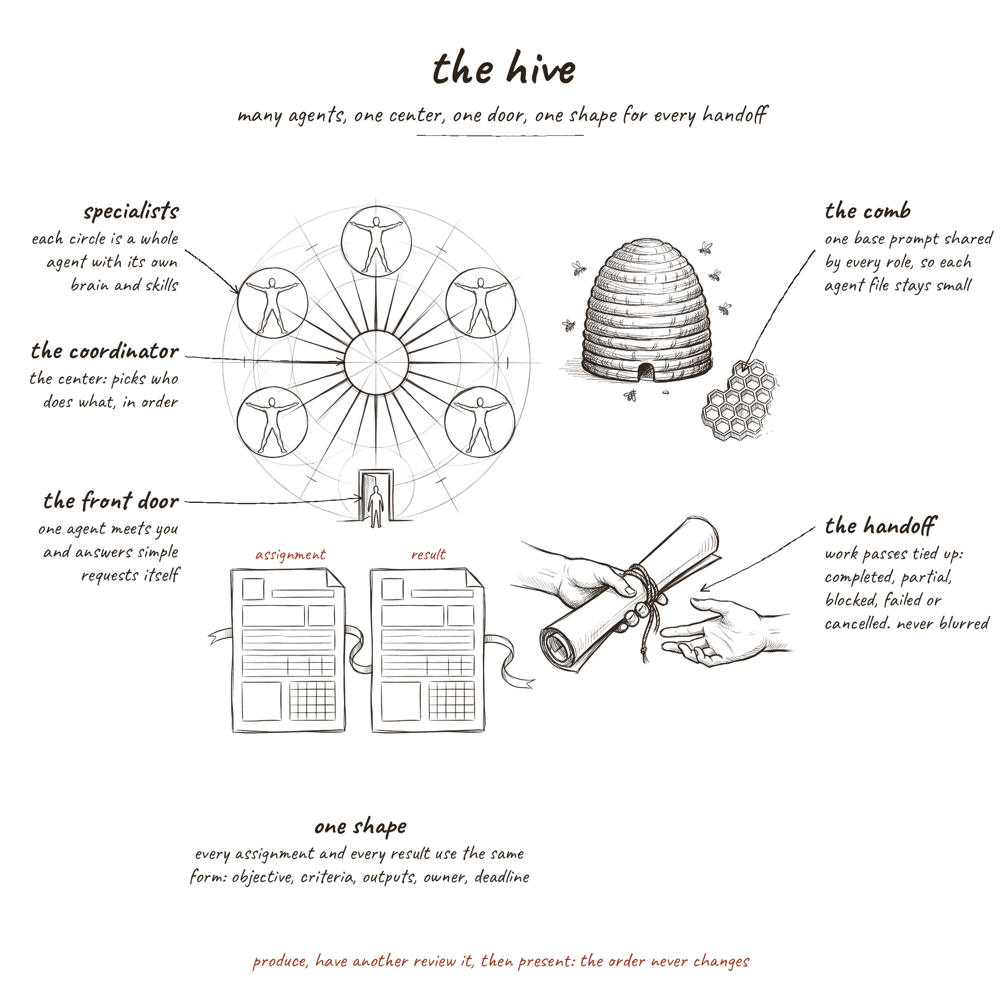
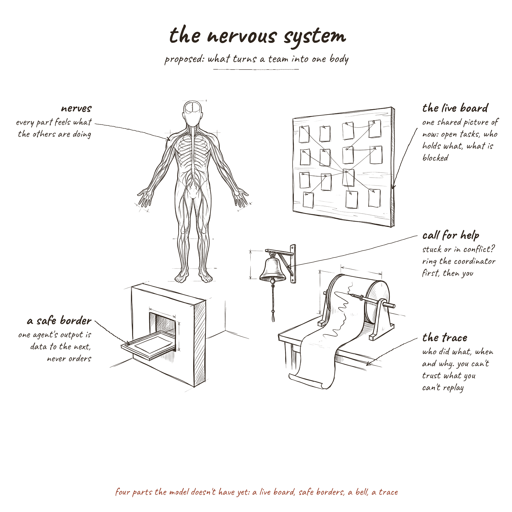

<p align="center">
  
</p>

<h1 align="center">The Hive Mind</h1>

<p align="center">
  <strong>How to design AI agents that work as one.</strong><br>
  The parts of a single agent, the team around it, and the nervous system that joins them.
</p>

<p align="center">
  
  
  
  
  
</p>

<p align="center">
  <a href="guide/README.md"><strong>Read the guide</strong></a> ·
  <a href="the-hive-mind-research-guide.pdf"><strong>Download the PDF</strong></a> ·
  <a href="https://www.youtube.com/watch?v=vIEHmB4QXuc"><strong>Watch the video</strong></a> ·
  <a href="https://agricidaniel.com/blog/how-to-design-an-ai-agent"><strong>Read the article</strong></a>
</p>

---

## A pile of words is not a mind

Most AI agents start life as one long prompt. It works for a week. Then a rule gets added for one client, another
for a new tool, a third after a bad output, and soon nobody can say which instruction lives where, which ones
contradict each other, or why the agent did what it did.

This guide builds an agent the other way: like a body. Each part has one job and lives in its own small file.
Everything the team shares is written once, and every agent links to it instead of keeping a copy. When there is
more than one agent, a team layer decides how they hand work to each other, and a nervous system lets the team
sense itself as one body.

Then every part was checked against published research and practice: 85 sources, from Anthropic, OpenAI, Google,
Meta and Microsoft to OWASP, NIST and peer reviewed papers. Each chapter says plainly where the design matches the
evidence, where it goes further, and what to watch for.

## The nine parts

| | Part | The question it answers |
|---|---|---|
| 1 | [Identity](guide/01-identity.md) | Who is this agent, and what is its job? |
| 2 | [Shared memory](guide/02-shared-memory.md) | What does it know, and how does it read it? |
| 3 | [Skills](guide/03-skills.md) | What does it know how to do? |
| 4 | [Tools](guide/04-tools.md) | What can it reach, and what stops it? |
| 5 | [Method](guide/05-method.md) | How does the work move, step by step? |
| 6 | [Limits](guide/06-limits.md) | How far may it go on its own? |
| 7 | [Loop](guide/07-loop.md) | How is its work checked and improved? |
| 8 | [The hive](guide/08-the-hive.md) | How do agents hand work to each other? |
| 9 | [The nervous system](guide/09-the-nervous-system.md) | How does the team feel itself as one body? *(proposed)* |

[Putting it together](guide/10-putting-it-together.md) closes with a build order and what is genuinely new here.
[References](guide/references.md) lists all 85 sources.

Every chapter follows the same shape: the idea in plain words, the drawings one element at a time, what research
and practice say, an honest comparison (matches, goes further, watch for), and a checklist you can apply to your own
agents today.

## One thread runs through all of it

> **Written rules guide an agent, but only enforcement controls it.**

A soul file that "grants no power", a skill that "grants no permission", a result that is "data, never orders":
each is a good rule, and each needs a matching lock in configuration, code or process. So the guide keeps asking one
question of every rule: *what actually stops the agent if it ignores this?*

## How the team works

One agent first. When the work needs more than one, the hive gives them one front door, one coordinator, one shape
for every handoff, and a reviewer who is never the author.



## Ten principles

1. Link, don't copy. Each fact lives in one place.
2. Separate who an agent is from what it does.
3. Keep agent files small. Push shared rules down into the team layer.
4. Give each agent its own expertise and shared rules from one source.
5. Write procedures down once and reuse them.
6. Give every input and output a template.
7. Set limits before adding power.
8. Check work with someone other than the author.
9. Turn every mistake into a rule, a test or a template change.
10. Keep readiness separate: a task can be ready, an agent can be ready, and permission to run is a third, separate
    gate.

## How to use it

**Read it.** Start at the [guide's home page](guide/README.md) and follow the links, or take the
[PDF](the-hive-mind-research-guide.pdf): the same text, laid out for reading offline or printing.

**Use the checklists.** Each chapter ends with one. Run it against an agent you already have and fix what fails.
For example, from [Identity](guide/01-identity.md):

- [ ] Keep the soul to voice and tone. Move every behaviour rule into the role or a shared guideline.
- [ ] Enforce permissions in configuration, hooks or approval gates, never in role or soul text.
- [ ] Set each agent's tool list on purpose instead of inheriting the runtime default.

**Build in order.** Do not start with a team. Both Anthropic and OpenAI advise the simplest system that works, and
adding agents only when the work needs them. Prove each layer before you add the next:

| Stage | Add | Done when |
|---|---|---|
| 1. One agent | A role file, a soul file, one shared rules file | The agent does one job well, in a voice you recognise |
| 2. Skills | Three skills, each with a with and without test | Each skill actually improves the work |
| 3. Tools | Tools at permission none, then opened one by one | Nothing reaches outside without a gate |
| 4. Method | One workflow with a review gate and an output template | The same job comes out the same way twice |
| 5. Limits | An action ceiling and a fresh yes for final actions | Nothing costly or public happens unasked |
| 6. Loop | An independent verifier and 20 or more test briefs | Quality is measured, not assumed |
| 7. Team | A front door, a coordinator, one handoff contract | More agents add capacity, not confusion |
| 8. Nerves | A live board, typed results, an escalation ladder, a trace | The team can see, protect and audit itself |

## The study sheets

Each part has its own sheet of drawings. In the guide they are cut into single studies, one for each idea. Click a
sheet for the full size.

<table>
  <tr>
    <td align="center"><a href="drawings/01-identity.png"></a><br><sub>1. Identity</sub></td>
    <td align="center"><a href="drawings/02-shared-memory.png"></a><br><sub>2. Shared memory</sub></td>
    <td align="center"><a href="drawings/03-skills.png"></a><br><sub>3. Skills</sub></td>
  </tr>
  <tr>
    <td align="center"><a href="drawings/04-tools.png"></a><br><sub>4. Tools</sub></td>
    <td align="center"><a href="drawings/05-method.png"></a><br><sub>5. Method</sub></td>
    <td align="center"><a href="drawings/06-limits.png"></a><br><sub>6. Limits</sub></td>
  </tr>
  <tr>
    <td align="center"><a href="drawings/07-loop.png"></a><br><sub>7. Loop</sub></td>
    <td align="center"><a href="drawings/08-the-hive.png"></a><br><sub>8. The hive</sub></td>
    <td align="center"><a href="drawings/09-the-nervous-system.png"></a><br><sub>9. The nervous system</sub></td>
  </tr>
</table>

## About the evidence

- **Primary sources only.** Engineering writing and documentation from the labs that build agents, security
  guidance from OWASP and NIST, and peer reviewed papers and preprints. Every source was opened and read on
  27 October 2026, and every claim links to its source in a footnote.
- **Numbers keep their context.** A figure describes the settings of the study it comes from, not every agent system.
- **Original ideas are labelled as original.** Where the design goes further than published practice, the guide says
  so instead of passing it off as a research finding. Examples: binding every approval to the exact version of the
  work, letting only a human turn a mistake into a rule, and keeping readiness, dispatch and permission as three
  separate gates.
- **The nervous system is a proposal.** Chapter 9 describes parts the model does not have yet. Live state and
  tracing are standard in current frameworks; trust between agents is still the least solved problem in the field.
- **Take the ideas, not the wording.** "The model" in the guide means one real agent layers model and its example
  files, built for a 17 agent marketing team. Your agents will need their own words.

## What's in the repo

```text
README.md                            you are here
the-hive-mind-research-guide.pdf     the full guide, 42 pages
guide/                               the same guide as Markdown, one chapter per file
  README.md                          the home page: the parts, how to read, ten principles
  01-identity.md ... 09-the-nervous-system.md
  10-putting-it-together.md          the build order and what is new
  references.md                      all 85 sources, numbered
  assets/                            the single drawings used in the chapters
drawings/                            the ten full study sheets, 2400 x 2400
CITATION.cff                         citation details for GitHub's "Cite this repository"
LICENSE                              Creative Commons Attribution 4.0
```

## Cite it

> Agrici, D. (2026). *The Hive Mind: How to design AI agents that work as one.* https://github.com/AgriciDaniel/hive-mind

GitHub's **Cite this repository** button gives the same in APA and BibTeX.

## License

The text and the drawings are licensed under [Creative Commons Attribution 4.0](LICENSE). You may share and adapt
them for any purpose, including commercial use, as long as you give credit, for example:
*"The Hive Mind" by Daniel Agrici, CC BY 4.0.*

The sources belong to their authors. The guide quotes them briefly and links to the originals rather than copying
them. Company and product names belong to their owners; this is an independent guide, not affiliated with or
endorsed by any of them.

## Made by

[Daniel Agrici](https://agricidaniel.com). I build AI marketing tools and agent systems, and show how on
[YouTube](https://www.youtube.com/watch?v=vIEHmB4QXuc).
Build your own agent team with us in the free [AI Marketing Hub](https://skool.com/ai-marketing-hub), or every week
in [AI Marketing Hub Pro](https://skool.com/ai-marketing-hub-pro).

Found a mistake, a dead link or a better source? [Open an issue](https://github.com/AgriciDaniel/hive-mind/issues).
