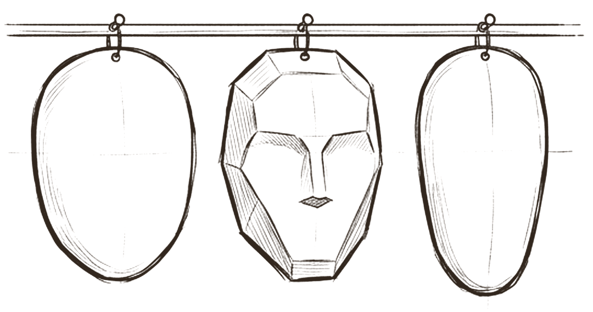
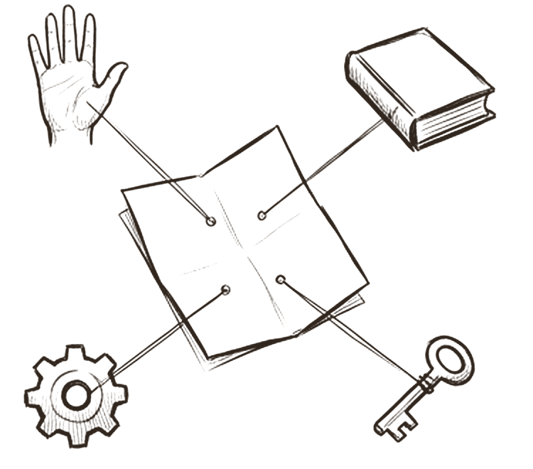

# Identity

*Who is this agent, and what is its job?*

Every agent starts with two small files. The **role** (AGENT.md) is the job: its purpose, when to use it, what it takes in, what it hands back, how it works, who reviews it, and what it must never do. The **soul** (SOUL.md) is the character: voice, tone and the way it talks. The two are kept apart on purpose, and when they disagree, the role wins.

The split sounds cosmetic. It is not. It lets you change the job without touching the voice, keep one voice across many jobs, and see at a glance where a rule lives. It also draws the first and most important line in this whole model: describing an agent is not the same as giving it power.

## The job, written as a specification

 <em>the shell and the core</em> · <strong>The role</strong>

The outer shell of the head is the role. It answers practical questions a manager would ask on day one: what is this agent for, when should anyone call it, what must they give it, what will they get back, and where does its job end. In this model the role file follows a fixed template: *When to use*, *Inputs*, *Outputs*, *Working method*, *Collaboration and review* and *Boundaries*.

Precision here is not a nicety. In a study of 1,642 multi agent traces, agents disobeying their task specification was one of the most common failures, and improving role specifications alone raised one system's success rate by 9.4 points with the same model and prompt [^mast]. Anthropic's research team reached the same conclusion from practice: each agent needs an objective, an output format, guidance on tools and sources, and clear boundaries, or agents duplicate work and leave gaps [^anthropic-multiagent]. Write the *does not do* list as carefully as the *does* list.

## Voice, not power

 <em>the mask</em> · <strong>The soul</strong>

The face behind the mask is the soul: how the agent sounds, what it cares about in a sentence, how it greets you. A role in the system prompt measurably focuses behaviour and tone [^prompting], so a well written soul is worth having.

What a soul cannot do is make the agent more accurate. Controlled tests on objective questions found that adding personas gave no reliable gain, and the effect of a given persona was close to random [^persona-zheng]. Persona descriptions can even carry hidden reasoning bias [^gupta-bias]. That is why the model says the soul **grants no power**: it controls voice only, never capability, authority or procedure. Keep every *do* and *do not* rule in the role or a shared guideline, and let the soul describe only how the agent speaks.

## Same character, new job

 <em>swap the role</em> · <strong>Separation</strong>

Because the two files are separate, a soul can hang on the wall while the role changes. A team can give its research agent and its writing agent the same house voice, or move one character to a new job without rewriting how it talks.

The conflict rule, *the role wins*, is a good design rule, but a written precedence rule is not something a model follows reliably. Claude Code's own documentation warns that when two instructions contradict each other, the model may pick one arbitrarily [^claude-memory]. Personas also drift: instruction adherence decays measurably within eight rounds of conversation [^li-drift], and post training only loosely anchors a model to its default character [^assistant-axis][^persona-vectors]. So keep the soul free of anything that could conflict with the role, and add a test where they do conflict, to prove the role wins.

## The identity file is an index

 <em>a small file</em> · <strong>Links, not copies</strong>

The role file names the skills, brains, workflows and tools the agent uses, and links to each one. It never copies them. Change a skill once and every agent that links to it gets the change; there is no second copy to fall out of date.

This matches the most common advice in vendor guidance: one shared base prompt with variables instead of many long separate prompts [^openai-guide], and instruction files kept short, because longer files reduce adherence [^claude-memory]. Links are also cheap. Only names and descriptions load until a part is needed [^agent-skills]. One caution: a link list is not an allowlist. In Claude Code, an agent definition without a tools field inherits every available tool [^claude-subagents], so the safe default has to be set on purpose, in configuration, not in prose.

> *the job can change, the character stays*

## What research and practice say

- **Vague roles are a measured cause of failure.** Disobeying the task specification and drifting into another agent's role are named failure modes in multi agent systems; clearer role specs alone improved results [^mast][^anthropic-multiagent].
- **Personas change tone, not accuracy.** A role in the prompt focuses tone [^prompting], but personas do not improve performance on objective questions [^persona-zheng] and can introduce bias [^gupta-bias].
- **Personas drift over a conversation.** Adherence decays within a few rounds, and certain conversations pull models away from their default character [^li-drift][^assistant-axis].
- **Authority is enforced outside the text.** OWASP's advice is to implement authorization in downstream systems rather than letting the model decide; Claude Code treats instruction files as context, not enforced configuration [^owasp-llm06][^claude-memory].
- **One base prompt, short files.** Shared rules belong in a single base prompt; each role adds only what is specific to it [^openai-guide][^context-eng].
- **An agent is also a security principal.** Standards bodies now treat agents as things that need their own identity, authorization and audit trail [^nist-agent-identity][^owasp-agentic].

## How the model compares

> [!TIP]
> **Matches practice**
>
> - The role and soul split puts the job in one file and tone in another, which is the only thing personas reliably change.
> - "The soul grants no power" matches OWASP's complete mediation and Claude Code's warning that instruction files are not enforcement.
> - The role template covers objective, inputs, outputs, tools and boundaries.
> - A shared base prompt, *Working with the team*, is read by every role.

> [!IMPORTANT]
> **Goes further**
>
> - An explicit conflict rule, *the role wins*, which most vendor guides never state.
> - Readiness, dispatch and permission are three separate fields (status, dispatch, action ceiling) instead of one on and off switch.
> - Collaborators and reviewers are named inside the role, so handoff and review are part of the job description.

> [!WARNING]
> **Watch for**
>
> - *Role wins* is prose. It needs a test where role and soul conflict.
> - The example soul repeats rules from its role (on evidence and rankings), which breaks *link, don't copy*.
> - No test checks that an agent stays in role over a long session or under a persona based jailbreak.
> - Named, pictured agents invite people to over trust them, a risk NIST lists under human and AI configuration [^nist-600-1].
> - The role names a job but not the credential or audit identity the agent acts under.

## Checklist

- [ ] Write the role as a job spec: purpose, when to use, inputs, outputs, handoffs and an explicit *does not do* list.
- [ ] Keep the soul to voice and tone. Move every behaviour rule into the role or a shared guideline.
- [ ] State that the role wins, then add one test case where they conflict.
- [ ] Enforce permissions in configuration, hooks or approval gates, never in role or soul text.
- [ ] Set each agent's tool list on purpose instead of inheriting the runtime default.
- [ ] Add a long session drift test and a persona jailbreak test to the agent's evals.
- [ ] Give each agent its own credential and audit identity.
- [ ] Keep each role file well under 200 lines; push shared rules into the base prompt.

---
Previous: [The Hive Mind](README.md)  ·  Home: [The Hive Mind](README.md)  ·  Next: [Shared memory](02-shared-memory.md)

[^mast]: Mert Cemri, Melissa Z. Pan, Shuyi Yang et al., "Why Do Multi-Agent LLM Systems Fail?", arXiv 2503.13657, v3 26 October 2025. https://arxiv.org/abs/2503.13657 ([all references](references.md#mast))
[^anthropic-multiagent]: Jeremy Hadfield, Barry Zhang, Kenneth Lien, Florian Scholz, Jeremy Fox and Daniel Ford, "How we built our multi-agent research system", Anthropic Engineering, 13 June 2025. https://www.anthropic.com/engineering/multi-agent-research-system ([all references](references.md#anthropic-multiagent))
[^prompting]: Anthropic, "Prompting best practices", Claude Platform documentation, read 27 October 2026. https://platform.claude.com/docs/en/build-with-claude/prompt-engineering/claude-prompting-best-practices ([all references](references.md#prompting))
[^persona-zheng]: Mingqian Zheng, Jiaxin Pei, Lajanugen Logeswaran, Moontae Lee and David Jurgens, "When 'A Helpful Assistant' Is Not Really Helpful: Personas in System Prompts Do Not Improve Performances of Large Language Models", Findings of EMNLP 2024, arXiv 2311.10054. https://arxiv.org/abs/2311.10054 ([all references](references.md#persona-zheng))
[^gupta-bias]: Shashank Gupta et al., "Bias Runs Deep: Implicit Reasoning Biases in Persona-Assigned LLMs", ICLR 2024, arXiv 2311.04892. https://arxiv.org/abs/2311.04892 ([all references](references.md#gupta-bias))
[^claude-memory]: Anthropic, "How Claude remembers your project", Claude Code documentation, read 27 October 2026. https://code.claude.com/docs/en/memory ([all references](references.md#claude-memory))
[^li-drift]: Kenneth Li et al., "Measuring and Controlling Instruction (In)Stability in Language Model Dialogs", COLM 2024, arXiv 2402.10962. https://arxiv.org/abs/2402.10962 ([all references](references.md#li-drift))
[^assistant-axis]: Christina Lu, Jack Gallagher, Jonathan Michala, Kyle Fish and Jack Lindsey, "The Assistant Axis: Situating and Stabilizing the Default Persona of Language Models", arXiv 2601.10387, 15 January 2026. https://arxiv.org/abs/2601.10387 ([all references](references.md#assistant-axis))
[^persona-vectors]: Anthropic, "Persona vectors: Monitoring and controlling character traits in language models", 1 August 2025. https://www.anthropic.com/research/persona-vectors ([all references](references.md#persona-vectors))
[^openai-guide]: OpenAI, "A practical guide to building agents", PDF, April 2025 (date from file metadata). https://cdn.openai.com/business-guides-and-resources/a-practical-guide-to-building-agents.pdf ([all references](references.md#openai-guide))
[^agent-skills]: Barry Zhang, Keith Lazuka and Mahesh Murag, "Equipping agents for the real world with Agent Skills", Anthropic Engineering, 16 October 2025, updated 18 December 2025. https://www.anthropic.com/engineering/equipping-agents-for-the-real-world-with-agent-skills ([all references](references.md#agent-skills))
[^claude-subagents]: Anthropic, "Create custom subagents", Claude Code documentation, read 27 October 2026. https://code.claude.com/docs/en/sub-agents ([all references](references.md#claude-subagents))
[^owasp-llm06]: OWASP GenAI Security Project, "LLM06:2025 Excessive Agency", Top 10 for LLM Applications 2025. https://genai.owasp.org/llmrisk/llm062025-excessive-agency/ ([all references](references.md#owasp-llm06))
[^context-eng]: Prithvi Rajasekaran, Ethan Dixon, Carly Ryan and Jeremy Hadfield, "Effective context engineering for AI agents", Anthropic Engineering, 29 September 2025. https://www.anthropic.com/engineering/effective-context-engineering-for-ai-agents ([all references](references.md#context-eng))
[^nist-agent-identity]: NIST NCCoE, "New Concept Paper on Identity and Authority of Software Agents", 5 February 2026. https://www.nist.gov/news-events/news/2026/02/new-concept-paper-identity-and-authority-software-agents ([all references](references.md#nist-agent-identity))
[^owasp-agentic]: OWASP GenAI Security Project, "OWASP Top 10 for Agentic Applications for 2026", 9 December 2025. https://genai.owasp.org/resource/owasp-top-10-for-agentic-applications-for-2026/ ([all references](references.md#owasp-agentic))
[^nist-600-1]: NIST, "Artificial Intelligence Risk Management Framework: Generative Artificial Intelligence Profile" (NIST AI 600-1), July 2024. https://nvlpubs.nist.gov/nistpubs/ai/NIST.AI.600-1.pdf ([all references](references.md#nist-600-1))
