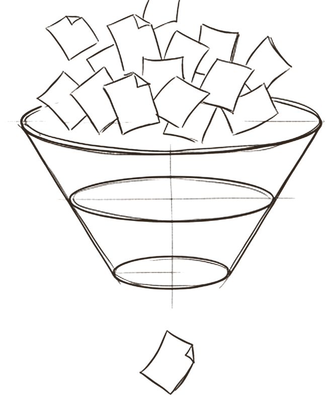
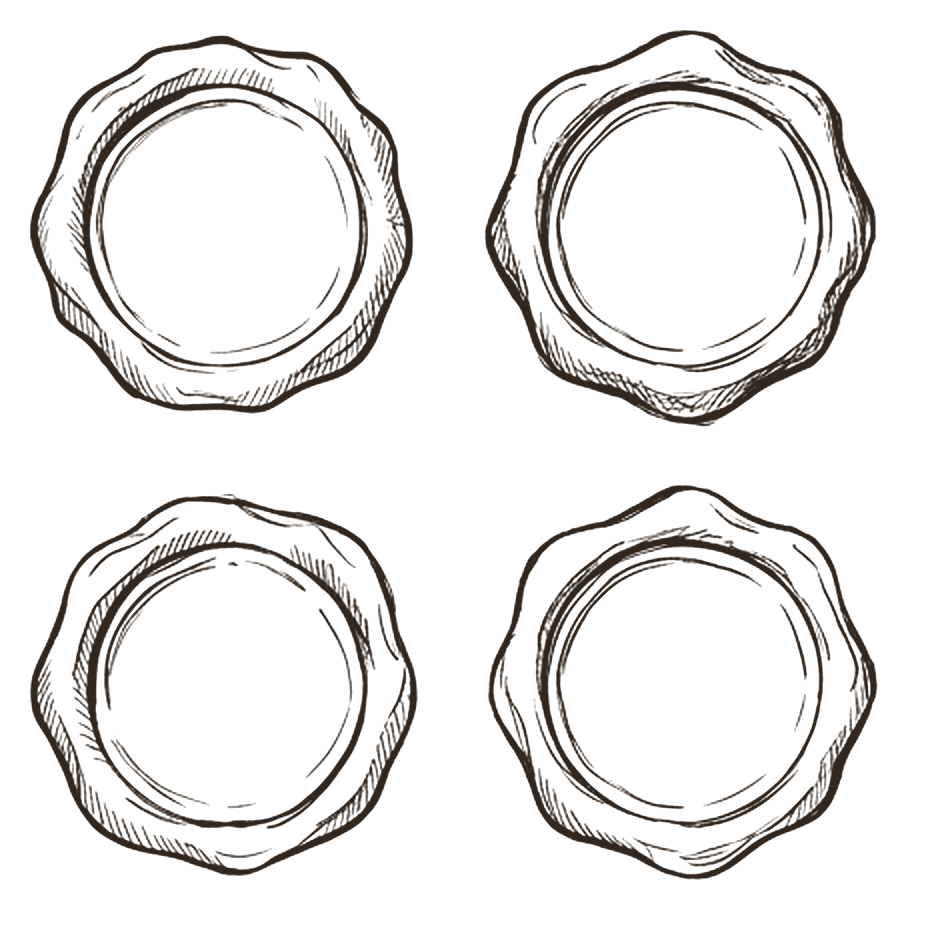

# Shared memory

*What does every agent know, and how does it read it?*

Memory in this model has two homes. Each agent has its own **brains**: deep domain expertise kept with its sources, owned by that agent. The whole team shares **knowledge**: rules on naming, evidence, context and writing, written once and linked by everyone. Around both sit three habits: load context in a fixed order and ask when something is missing, read the smallest useful slice instead of the whole library, and label every claim with where it came from.

Memory is the part of an agent that compounds. It is also the part that an attacker most wants to poison, and the part that silently decays when two writers edit the same file. This chapter treats it with the care of a shared database, because that is what it is.

## Brains and the order of context

 <em>brains</em> · <strong>Own expertise</strong>

A brain is a folder of notes about one domain, such as technical SEO, kept with the sources behind each note. It belongs to one agent, and only that agent's owner changes it. Research on language agents calls this *semantic memory*: an agent's knowledge about the world [^coala].

When a task starts, context loads in a fixed order: project, then client, then brand, then audience. If a required piece is missing, the agent asks. It never guesses a brand or an audience. This is not caution for its own sake. Models guess partly because training and scoring reward guessing over saying *I don't know* [^kalai], and *proceeding with wrong assumptions instead of seeking clarification* shows up in 6.8% of analysed multi agent traces [^mast]. Abstention is a recognised safety tool [^know-limits]; the model makes it the default.

## Knowledge, and one writer per file

 <em>written once, linked by all</em> · <strong>Shared rules</strong>

The open book in the centre is shared knowledge: the guidelines every agent follows, from how files are named to what counts as evidence. They are written once and linked from every role. This is what research calls *procedural memory*, the rules that drive behaviour, and changing it is singled out as the riskiest kind of learning, because it can introduce bugs or let an agent subvert its designers' intentions [^coala]. Treat a guideline change like a code change: reviewed and tested.

Writes follow one rule: **agents return drafts; one owner changes each shared file**. The owner reads the file, records its hash, applies the change, and refuses if the file changed in between. Parallel agents acting on different pictures of the same state is a known source of failure; as one practitioner put it, *actions carry implicit decisions, and conflicting decisions carry bad results* [^cognition].

## Read the map, then a bundle, then only what the task needs

 <em>three tiers</em> · <strong>Just in time</strong>

The agent never loads the whole library. It reads in three tiers: first a map with names and one line descriptions, then a small resolved bundle for the task, then only the extra notes the task actually asks for, under a fixed cap.

This is the pattern Anthropic describes as context engineering: find the smallest set of high signal tokens, hold lightweight references such as file paths, and load content at runtime [^context-eng]. The reason is measurable. Across 18 models, performance fell as input grew longer [^chroma], and facts placed in the middle of a long context are used worse than facts at the start or end [^lost-middle]. Two refinements follow: put the task and its constraints at the start or end of the bundle, never in the middle, and test retrieval itself, because a word cap controls volume, not whether the right notes were found. For a small collection, loading everything with caching can be fine [^contextual-retrieval]; the rule is about relevance, not a ban.

## Every claim says where it came from

 <em>raw · fetch · search · infer</em> · <strong>Evidence</strong>

Each stored fact carries one of four labels. **RAW** is a kept source. **FETCH** means the agent read it directly in this run. **SEARCH** means it was only found by search and not checked. **INFER** means it was reasoned from other evidence. Search is a discovery aid, never evidence by itself. When evidence is missing, the honest answer is *no data*, which beats any guess.

Most guidance says *cite your sources* and stops there. Retrieval augmented generation was invented partly because models cannot show where a claim came from [^rag-lewis], NIST names confident false output as a core risk [^nist-600-1], and research on shared agent memory attaches fixed provenance to every memory item [^collab-memory]. The four labels go further than any of these. One caution: a label is also a claim. The strongest version checks every FETCH label against the run's actual fetch log.

> *link, don't copy: each fact lives in one place*

## What research and practice say

- **Separate the kinds of memory.** Working, episodic, semantic and procedural memory carry different risks; writing procedural memory is the riskiest [^coala].
- **Load the least context that does the job.** Smaller, relevant context beats long context; long inputs degrade results and bury facts in the middle [^context-eng][^chroma][^lost-middle].
- **Keep provenance attached to every fact.** Provenance and confabulation are core risks; shared memory systems attach provenance to each item [^rag-lewis][^nist-600-1][^collab-memory].
- **Reward *I don't know*.** Models guess because scoring rewards it; abstention reduces hallucination when evaluation rewards it too [^kalai][^know-limits].
- **Memory is an attack surface, and poison persists.** Poisoning under 0.1% of a memory store reached over 80% attack success [^agentpoison]; attackers can plant records just by talking to an agent [^minja]; OWASP lists memory and context poisoning as an agentic risk [^owasp-agentic-summary].
- **Coordinate writes.** Agents acting on different pictures of shared state make conflicting decisions; shared artifacts with clear ownership help [^cognition][^anthropic-multiagent].

## How the model compares

> [!TIP]
> **Matches practice**
>
> - Brains and shared knowledge match the semantic and procedural split in agent research.
> - The three retrieval tiers are a concrete version of *lightweight references, loaded just in time*.
> - "Ask, never guess" and the *no data* and *needs input* states match the abstention research.
> - One owner per shared file, with a hash check before applying, matches the advice on coordinated writes.

> [!IMPORTANT]
> **Goes further**
>
> - Splitting FETCH from SEARCH and treating search as discovery, not evidence, is stricter than any vendor guidance found.
> - Provenance is kept separate from evidence tier, verdict and confidence.
> - Freshness horizons block stale sources instead of only expiring unused files.

> [!WARNING]
> **Watch for**
>
> - No write time check on new brain notes for embedded instructions, and no documented rollback for a poisoned note.
> - Episodic memory, *what happened last time*, has no named home or writer.
> - Word caps control volume, not relevance; nothing tests that the right notes were retrieved.
> - If *no data* is rewarded and never balanced, agents may stall on answerable tasks. Track the rate.

## Checklist

- [ ] Sort every stored item into domain facts, shared rules or past events, each with one owner and one write path.
- [ ] Attach provenance when a fact is written: source, how it was obtained, date and freshness horizon.
- [ ] Start each task from a map and a small bundle; put the task at the start or end of context.
- [ ] Make the agent ask when a decision is missing and return *no data* when evidence is missing.
- [ ] Scan new notes for embedded instructions before they enter memory, and keep a rollback point.
- [ ] Allow one writer per shared file; check the hash before applying any change.
- [ ] Review and test every change to shared rules as you would a code change.
- [ ] Test retrieval: for sample tasks, check the bundle contains the notes the task needs.

---
Previous: [Identity](01-identity.md)  ·  Home: [The Hive Mind](README.md)  ·  Next: [Skills](03-skills.md)

[^coala]: Theodore R. Sumers, Shunyu Yao, Karthik Narasimhan and Thomas L. Griffiths, "Cognitive Architectures for Language Agents", TMLR, arXiv 2309.02427. https://arxiv.org/abs/2309.02427 ([all references](references.md#coala))
[^kalai]: Adam Tauman Kalai, Ofir Nachum, Santosh S. Vempala and Edwin Zhang, "Why Language Models Hallucinate", arXiv 2509.04664, 4 September 2025. https://arxiv.org/abs/2509.04664 ([all references](references.md#kalai))
[^mast]: Mert Cemri, Melissa Z. Pan, Shuyi Yang et al., "Why Do Multi-Agent LLM Systems Fail?", arXiv 2503.13657, v3 26 October 2025. https://arxiv.org/abs/2503.13657 ([all references](references.md#mast))
[^know-limits]: Bingbing Wen et al., "Know Your Limits: A Survey of Abstention in Large Language Models", TACL, arXiv 2407.18418. https://arxiv.org/abs/2407.18418 ([all references](references.md#know-limits))
[^cognition]: Walden Yan, "Don't Build Multi-Agents", Cognition, 12 June 2025. https://cognition.com/blog/dont-build-multi-agents ([all references](references.md#cognition))
[^context-eng]: Prithvi Rajasekaran, Ethan Dixon, Carly Ryan and Jeremy Hadfield, "Effective context engineering for AI agents", Anthropic Engineering, 29 September 2025. https://www.anthropic.com/engineering/effective-context-engineering-for-ai-agents ([all references](references.md#context-eng))
[^chroma]: Kelly Hong, Anton Troynikov and Jeff Huber, "Context Rot: How Increasing Input Tokens Impacts LLM Performance", Chroma, 14 July 2025. https://www.trychroma.com/research/context-rot ([all references](references.md#chroma))
[^lost-middle]: Nelson F. Liu et al., "Lost in the Middle: How Language Models Use Long Contexts", TACL, arXiv 2307.03172. https://arxiv.org/abs/2307.03172 ([all references](references.md#lost-middle))
[^contextual-retrieval]: Anthropic, "Introducing Contextual Retrieval", 19 September 2024. https://www.anthropic.com/news/contextual-retrieval ([all references](references.md#contextual-retrieval))
[^rag-lewis]: Patrick Lewis et al., "Retrieval-Augmented Generation for Knowledge-Intensive NLP Tasks", NeurIPS 2020, arXiv 2005.11401. https://arxiv.org/abs/2005.11401 ([all references](references.md#rag-lewis))
[^nist-600-1]: NIST, "Artificial Intelligence Risk Management Framework: Generative Artificial Intelligence Profile" (NIST AI 600-1), July 2024. https://nvlpubs.nist.gov/nistpubs/ai/NIST.AI.600-1.pdf ([all references](references.md#nist-600-1))
[^collab-memory]: Alireza Rezazadeh et al., "Collaborative Memory: Multi-User Memory Sharing in LLM Agents with Dynamic Access Control", arXiv 2505.18279, 23 May 2025. https://arxiv.org/abs/2505.18279 ([all references](references.md#collab-memory))
[^agentpoison]: Zhaorun Chen, Zhen Xiang, Chaowei Xiao, Dawn Song and Bo Li, "AgentPoison: Red-teaming LLM Agents via Poisoning Memory or Knowledge Bases", arXiv 2407.12784, 17 July 2024. https://arxiv.org/abs/2407.12784 ([all references](references.md#agentpoison))
[^minja]: Shen Dong et al., "Memory Injection Attacks on LLM Agents via Query-Only Interaction", arXiv 2503.03704, v5 12 February 2026. https://arxiv.org/abs/2503.03704 ([all references](references.md#minja))
[^owasp-agentic-summary]: Giskard, "OWASP Top 10 for Agentic Applications 2026" (secondary summary of the full list), December 2025. https://www.giskard.ai/knowledge/owasp-top-10-for-agentic-application-2026 ([all references](references.md#owasp-agentic-summary))
[^anthropic-multiagent]: Jeremy Hadfield, Barry Zhang, Kenneth Lien, Florian Scholz, Jeremy Fox and Daniel Ford, "How we built our multi-agent research system", Anthropic Engineering, 13 June 2025. https://www.anthropic.com/engineering/multi-agent-research-system ([all references](references.md#anthropic-multiagent))
