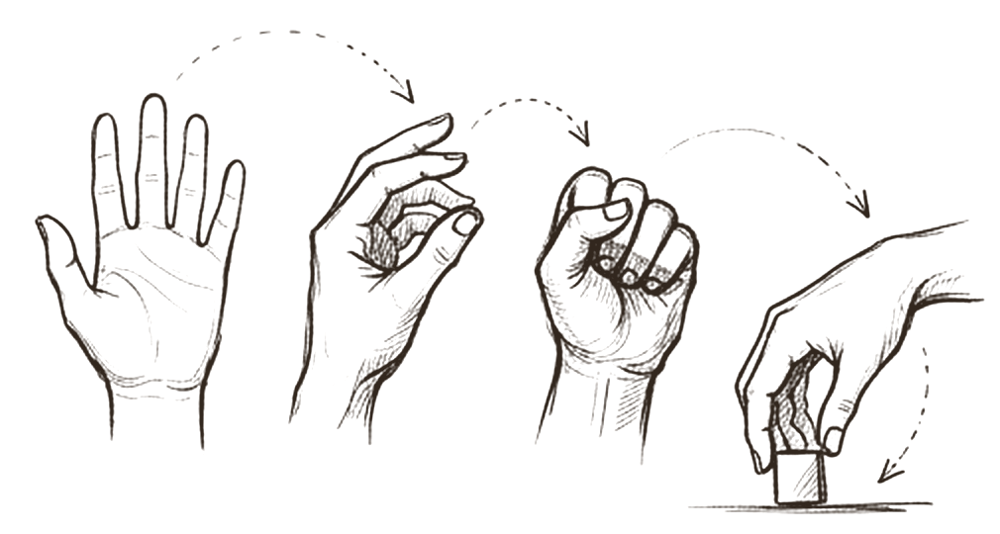
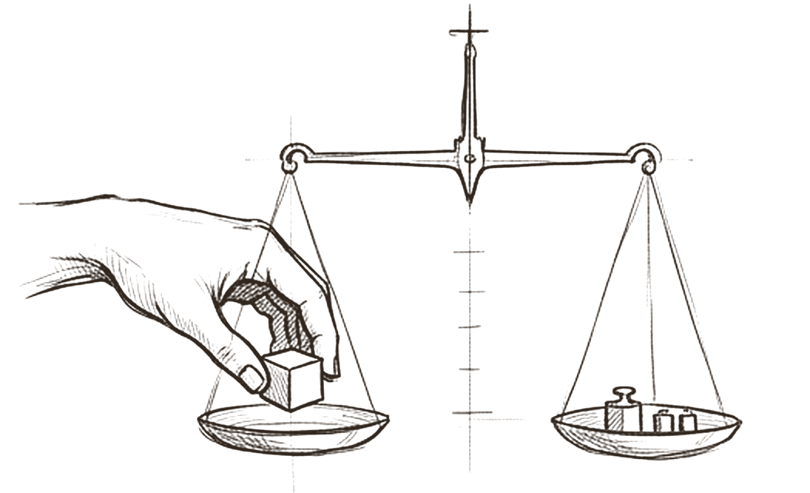

# Skills

*What does the agent know how to do?*

A skill is a practiced ability written down as instructions: an SEO audit, a competitor teardown, a weekly report. It has an outcome, a trigger, inputs, steps, one output and boundaries. It holds no client facts and no brand voice, because those live in memory and change from job to job. And it grants no access: knowing how to do something is not permission to do it.

Skills are where an agent's quality is most visible and most testable. They are also, by design, instructions, which makes them the easiest place to hide an instruction that should not be there.

## A packaged procedure with a clear trigger

 <em>what it knows</em> · <strong>The ability</strong>

The open palm is the skill itself: know-how, written down. Today the common format is a folder with a SKILL.md file and optional linked files. At startup only the name and a short description load for each skill; the body and extras load when the skill is used [^agent-skills].

That makes the description the trigger. The open specification limits it to 1,024 characters and says it must describe what the skill does and when to use it [^skills-spec]. Anthropic's guidance calls it critical for selection when there are a hundred or more skills to choose from [^skill-best]. Write it first, in the third person, with the words a person would actually use when they need it.

## Same motions, same order, every time

 <em>the steps</em> · <strong>The method</strong>

A skill is a short sequence of steps, each one an action with a visible result. Good skills come from real procedures, not imagination: OpenAI recommends building routines from existing operating procedures and policy documents, with a branch for when required information is missing [^openai-guide]. Anthropic adds a useful idea, *degrees of freedom*: loose guidance where many approaches work, exact scripts where a step is fragile or must be repeatable [^skill-best]. The research ancestor of today's skill folders, Voyager, kept a growing library of executable code and improved it from execution feedback [^voyager].

Keep it focused. The first large benchmark of skills found that curated skills raised the average pass rate from 33.9% to 50.5%, and that focused skills with at most three modules outperformed larger, exhaustive bundles [^skillsbench]. Under 500 lines for the body, and references one level deep, is the vendor ceiling [^skill-best].

## Inputs in, one output out, nothing invented

 <em>in and out</em> · <strong>The contract</strong>

The mill takes inputs at the top and drops one finished output at the bottom. What goes in is named: the site, the brief, the audience. What comes out has a fixed shape. And two failure states are named too. A **missing decision** returns *needs input*. **Missing evidence** returns *no data*. The skill never fills either gap with a guess.

The mill has no memory of its own. A skill holds no client facts and no brand voice; they arrive as inputs from memory. This keeps the skill reusable across clients and free of dated information, which vendor guidance specifically warns against putting in a skill body [^skill-best]. It also means one tested skill serves the whole team.

## Weighed against a baseline before it gets real work

 <em>tested first</em> · <strong>Evidence</strong>

A skill is scored on test briefs before it is trusted. This is the rule the research supports most strongly. Anthropic's guidance says to create evaluations before writing extensive documentation, with at least three of them [^skill-best], and Claude Code's documentation adds a sharp warning: seeing a skill trigger tells you it was found, not that it did what you intended. Run realistic prompts in a fresh session with the skill on, and again with it off [^claude-skills].

The reason is that skills can make things worse. In the same benchmark, 16 of 84 tasks scored lower with a skill than without one, and skills the model wrote for itself gave no benefit on average [^skillsbench]. Test two things: that the skill triggers on the right requests and stays quiet on the wrong ones, and that its output actually beats the baseline.

> *a skill is know-how, not permission: using it grants no access*

## What research and practice say

- **The description decides when a skill is used.** Only name and description load up front; the description must say what and when [^skills-spec][^skill-best][^agent-skills].
- **Focused beats exhaustive.** Curated skills improved pass rates by 16.6 points on average; skills with at most three modules did best [^skillsbench].
- **Write from real procedures; give code the exact steps.** Routines come from existing procedures, with a branch for missing information; fragile steps become scripts [^openai-guide][^skill-best].
- **Test against a baseline.** Run with and without the skill. Some tasks get worse, and self written skills gave no average benefit [^claude-skills][^skillsbench].
- **Skills are a supply chain.** 26.1% of 31,132 public skills had at least one vulnerability, and skills bundling scripts were 2.12 times as likely to [^skills-wild]; skills enable trivially simple prompt injections [^skills-injection]. Install only from trusted sources and audit first [^agent-skills].
- **Keep permission out of the skill.** OWASP names excessive functionality, permissions and autonomy as root causes [^owasp-llm06]. Note that in Claude Code a skill's allowed tools field does grant permission for that turn [^claude-skills].

## How the model compares

> [!TIP]
> **Matches practice**
>
> - The skill template (outcome, use when, inputs, output, boundaries) follows the specification and best practices.
> - *Needs input* and *no data* turn the advice on missing information into a named contract.
> - Keeping client data and voice out of the skill keeps it reusable.
> - Ported source text is treated as untrusted and its hash recorded.

> [!IMPORTANT]
> **Goes further**
>
> - "This skill grants no external authority" is stricter than at least one popular runtime, where a skill can pre approve its own tools.
> - Three distinct states (*needs input*, *blocked*, *no data*) give more precise failure reports than any vendor guide reviewed.
> - Each skill records its source, version and port decision.

> [!WARNING]
> **Watch for**
>
> - The example SEO audit skill is active while its evaluation flag is false, and its text calls evaluation optional.
> - Evals check output, not whether the skill triggers on the right requests.
> - The example body is mostly provenance and legal boundary text; the method itself is five steps.
> - No step reviews bundled scripts for network calls or credential access before a skill goes live.

## Checklist

- [ ] Write the description first: what it does and when to use it, under 1,024 characters.
- [ ] Keep the body short and mostly procedure; move history and reference into linked files.
- [ ] Name what happens on a missing decision and on missing evidence. Never guess.
- [ ] Keep client data, brand voice and dated facts out of the skill.
- [ ] Use scripts for exact steps, and say whether the agent runs or only reads each one.
- [ ] Before marking a skill active, run three or more realistic tasks with and without it.
- [ ] Install skills only from trusted sources, and read every bundled file first.
- [ ] Grant tools through permission settings, not skill fields, and check what your runtime does.

---
Previous: [Shared memory](02-shared-memory.md)  ·  Home: [The Hive Mind](README.md)  ·  Next: [Tools](04-tools.md)

[^agent-skills]: Barry Zhang, Keith Lazuka and Mahesh Murag, "Equipping agents for the real world with Agent Skills", Anthropic Engineering, 16 October 2025, updated 18 December 2025. https://www.anthropic.com/engineering/equipping-agents-for-the-real-world-with-agent-skills ([all references](references.md#agent-skills))
[^skills-spec]: Agent Skills, "Specification", agentskills.io, read 27 October 2026. https://agentskills.io/specification ([all references](references.md#skills-spec))
[^skill-best]: Anthropic, "Skill authoring best practices", Claude Platform documentation, read 27 October 2026. https://platform.claude.com/docs/en/agents-and-tools/agent-skills/best-practices ([all references](references.md#skill-best))
[^openai-guide]: OpenAI, "A practical guide to building agents", PDF, April 2025 (date from file metadata). https://cdn.openai.com/business-guides-and-resources/a-practical-guide-to-building-agents.pdf ([all references](references.md#openai-guide))
[^voyager]: Guanzhi Wang et al., "Voyager: An Open-Ended Embodied Agent with Large Language Models", arXiv 2305.16291. https://arxiv.org/abs/2305.16291 ([all references](references.md#voyager))
[^skillsbench]: Xiangyi Li, Yimin Liu, Wenbo Chen et al., "SkillsBench: Benchmarking How Well Agent Skills Work Across Diverse Tasks", arXiv 2602.12670, v1 13 February 2026, v4 14 June 2026. https://arxiv.org/abs/2602.12670 ([all references](references.md#skillsbench))
[^claude-skills]: Anthropic, "Extend Claude with skills", Claude Code documentation, read 27 October 2026. https://code.claude.com/docs/en/skills ([all references](references.md#claude-skills))
[^skills-wild]: Yi Liu et al., "Agent Skills in the Wild: An Empirical Study of Security Vulnerabilities at Scale", arXiv 2601.10338, 15 January 2026. https://arxiv.org/abs/2601.10338 ([all references](references.md#skills-wild))
[^skills-injection]: David Schmotz, Sahar Abdelnabi and Maksym Andriushchenko, "Agent Skills Enable a New Class of Realistic and Trivially Simple Prompt Injections", arXiv 2510.26328, 30 October 2025. https://arxiv.org/abs/2510.26328 ([all references](references.md#skills-injection))
[^owasp-llm06]: OWASP GenAI Security Project, "LLM06:2025 Excessive Agency", Top 10 for LLM Applications 2025. https://genai.owasp.org/llmrisk/llm062025-excessive-agency/ ([all references](references.md#owasp-llm06))
