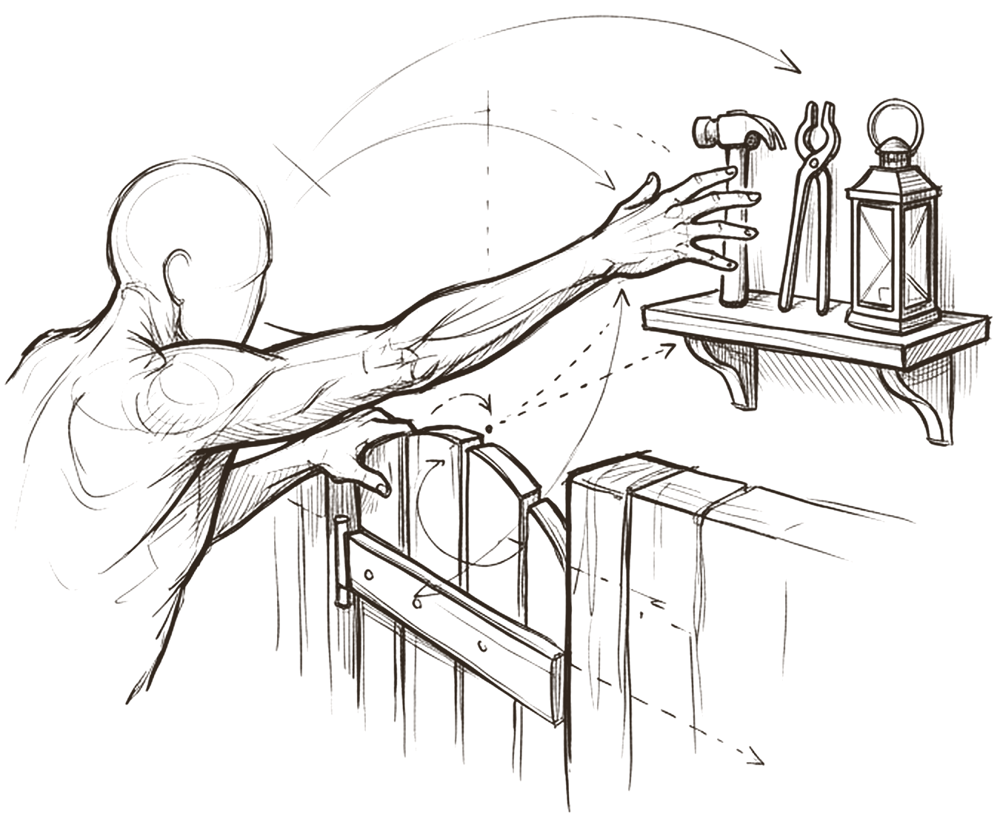
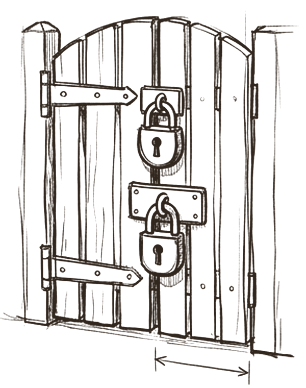
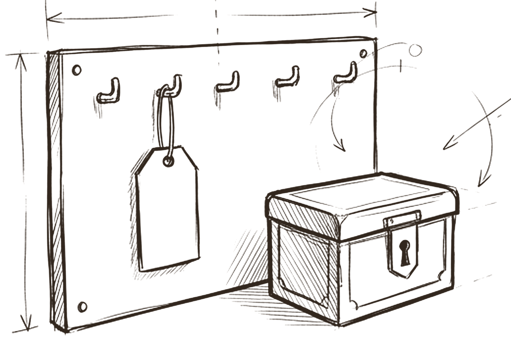

# Tools

*What can the agent reach, and what stops it?*

Tools are the outside services and data an agent can reach: a search API, a crawler, a CMS, a payment account. The model's rules are short. Capability is not authority. The default permission is none. Each tool lists which agents may use it and how far. Spending and writing each need their own human yes. A credential is stored by name, never by value. Budgets and rate limits are set before the first call. And every tool notes whether its actions can be undone.

Every one of those rules has strong support in security research going back fifty years. The new risk that agents add is not any single tool. It is what one agent holds at the same time.

## Being able to reach is not permission to reach

 <em>the reach</em> · <strong>Capability</strong>

The figure can touch everything on the shelf. That is capability. Whether it is allowed to pick anything up is a separate question, and the answer starts at **none**. Each tool is granted to one agent at a time, for named functions and a named scope.

This is the oldest rule in computer security. In 1975 Saltzer and Schroeder wrote that the default situation should be lack of access, with the protection scheme naming when access is permitted [^saltzer]. OWASP names excessive functionality, excessive permissions and excessive autonomy as the three root causes of excessive agency [^owasp-llm06]. Google adds that agents must be prevented from escalating their own privileges beyond pre authorised scopes [^google-secure]. And fewer tools are not only safer: Anthropic notes that more tools don't always lead to better outcomes [^writing-tools].

## Each tool lists who may pass, and how far

 <em>the gate, two locks</em> · <strong>Policy</strong>

Every tool has a note that works like a gate: which agents may use it, for which functions, at what level. Two actions get their own lock. **Spending** money and **writing** to anything outside each need a separate human yes, even for an agent already allowed through the gate.

The research adds two things. First, rate each tool's risk using read versus write access, reversibility, required permissions and financial impact, and let that rating decide the gate [^openai-guide]. MCP builds this into its tool hints with cautious defaults: unless told otherwise, a client assumes a tool may change things, may be destructive and may reach the outside world [^mcp-schema]. Second, the gate must be enforced outside the model. Claude Code's documentation is explicit that permission rules are enforced by the harness, not by the model [^claude-permissions], and Google places a deterministic policy engine outside the model's reasoning to check each action before it runs [^google-secure].

## Store the label, keep the key out of reach

 <em>the name, never the key</em> · <strong>Credentials</strong>

The tag on the hook carries the credential's name. The key itself stays locked in the box, in a secrets store the agent never reads directly. Notes, logs and transcripts hold the name only.

OWASP's guidance is the same: secrets live in a secrets manager, carry the minimum privileges, are rotated, and never appear in logs [^owasp-secrets]. Two refinements matter for teams. The agentic Top 10 asks for short lived, narrowly scoped tokens per task and per agent [^owasp-agentic], because one shared credential blurs who did what. And MCP forbids *token passthrough*: a server must not accept tokens that were not issued for it [^mcp-security].

## Spend, rate and time are capped before the first call

 <em>budget first</em> · <strong>Limits on use</strong>

Before an agent makes its first live call, the tool note fixes a spend cap, a rate limit, a timeout and what happens automatically when a limit is hit. In this model each paid call also needs a fresh human approval of an exact, costed plan with a maximum charge.

OWASP names the risk *denial of wallet*: running up cost on pay per use services [^owasp-llm10]. MCP requires servers to rate limit tool calls and tells clients to set timeouts [^mcp-tools]. The stakes grow with teams: Anthropic measured multi agent systems using about 15 times the tokens of a chat [^anthropic-multiagent]. The same note records whether the tool's actions can be undone, because reversibility is one of the main factors in how much oversight a tool needs [^openai-guide].

> *reaching is easy. permission to reach is the design*

## What research and practice say

- **Least privilege, by default.** Grant the fewest, narrowest tools; deny by default [^saltzer][^owasp-llm06][^google-secure].
- **Rate each tool's risk and let the rating decide the gate.** Read or write, reversibility, permissions and financial impact set the level of oversight [^openai-guide][^mcp-schema].
- **Enforce on every call, outside the model.** Rules in a prompt shape intent; only the harness or a policy engine controls what actually runs [^claude-permissions][^google-secure].
- **Credentials: scoped, short lived, referenced, never logged.** Per agent, per task tokens; no passthrough [^owasp-secrets][^owasp-agentic][^mcp-security].
- **Budgets before the first call.** Rate limits, quotas, timeouts and automatic cut offs prevent denial of wallet [^owasp-llm10][^mcp-tools].
- **Watch combinations, not just tools.** Text returned by tools can carry instructions [^greshake]. An agent holding private data, untrusted content and an outbound channel at once is the *lethal trifecta* [^trifecta]; Meta's Rule of Two says a session should hold no more than two of the three [^rule-of-two].

## How the model compares

> [!TIP]
> **Matches practice**
>
> - *Default permission: none* plus an allowed agents table is fail safe defaults and least privilege in practice.
> - "Capability is not authority" is complete mediation.
> - A credential reference holds a name, never a value.
> - Reversibility and spend fields match the main risk factors in OpenAI's guide.

> [!IMPORTANT]
> **Goes further**
>
> - Each paid call needs a fresh human approval of an exact, costed plan with a hard cap. Most frameworks allow standing allowances.
> - Failure, partial data, zero results and absence are four distinct recorded states.
> - Provider facts such as prices and endpoints must be checked against primary documentation before use.

> [!WARNING]
> **Watch for**
>
> - Each note judges one tool alone. Nothing checks what one agent holds together.
> - Reading is not automatically safe: a fetch can leak data through the URL. Data egress is not recorded.
> - No pinned version or hash of the reviewed tool definition, though MCP servers can change their tools at runtime.
> - No fields for switching a tool off, revoking its credential, or where its calls are logged.

## Checklist

- [ ] Start every tool at *no agent may call this*; grant one agent at a time with exact functions.
- [ ] Label each action: read only, additive, destructive, external send or spend. Unlabelled means destructive.
- [ ] For each agent, list what it holds together. Split work that combines private data, untrusted content and an outbound channel.
- [ ] Keep credentials in a secrets manager, one scoped credential per agent, with a rotation date.
- [ ] Write the budget cap, rate limit, timeout and automatic cut off before the first live call.
- [ ] Pin each tool's reviewed version and the hash of its definition; re review on change.
- [ ] Write down how to switch the tool off, revoke its credential and find its logs.
- [ ] Treat everything a tool returns as data, and test that with injection cases.

---
Previous: [Skills](03-skills.md)  ·  Home: [The Hive Mind](README.md)  ·  Next: [Method](05-method.md)

[^saltzer]: Jerome Saltzer and Michael Schroeder, "The Protection of Information in Computer Systems", 1975. https://www.cs.virginia.edu/~evans/cs551/saltzer/ ([all references](references.md#saltzer))
[^owasp-llm06]: OWASP GenAI Security Project, "LLM06:2025 Excessive Agency", Top 10 for LLM Applications 2025. https://genai.owasp.org/llmrisk/llm062025-excessive-agency/ ([all references](references.md#owasp-llm06))
[^google-secure]: Santiago Díaz, Christoph Kern and Kara Olive, "Google's Approach for Secure AI Agents: An Introduction", Google, 2025. https://research.google/pubs/an-introduction-to-googles-approach-for-secure-ai-agents/ ([all references](references.md#google-secure))
[^writing-tools]: Ken Aizawa et al., "Writing effective tools for agents, with agents", Anthropic Engineering, 11 September 2025. https://www.anthropic.com/engineering/writing-tools-for-agents ([all references](references.md#writing-tools))
[^openai-guide]: OpenAI, "A practical guide to building agents", PDF, April 2025 (date from file metadata). https://cdn.openai.com/business-guides-and-resources/a-practical-guide-to-building-agents.pdf ([all references](references.md#openai-guide))
[^mcp-schema]: Model Context Protocol, specification 2026-07-28, schema.ts, ToolAnnotations. https://github.com/modelcontextprotocol/specification/blob/main/schema/2026-07-28/schema.ts ([all references](references.md#mcp-schema))
[^claude-permissions]: Anthropic, "Configure permissions", Claude Code documentation, read 27 October 2026. https://code.claude.com/docs/en/permissions ([all references](references.md#claude-permissions))
[^owasp-secrets]: OWASP Cheat Sheet Series, "Secrets Management Cheat Sheet". https://cheatsheetseries.owasp.org/cheatsheets/Secrets_Management_Cheat_Sheet.html ([all references](references.md#owasp-secrets))
[^owasp-agentic]: OWASP GenAI Security Project, "OWASP Top 10 for Agentic Applications for 2026", 9 December 2025. https://genai.owasp.org/resource/owasp-top-10-for-agentic-applications-for-2026/ ([all references](references.md#owasp-agentic))
[^mcp-security]: Model Context Protocol, "Security Best Practices", read 27 October 2026. https://modelcontextprotocol.io/docs/tutorials/security/security_best_practices ([all references](references.md#mcp-security))
[^owasp-llm10]: OWASP GenAI Security Project, "LLM10:2025 Unbounded Consumption", Top 10 for LLM Applications 2025. https://genai.owasp.org/llmrisk/llm102025-unbounded-consumption/ ([all references](references.md#owasp-llm10))
[^mcp-tools]: Model Context Protocol, specification 2026-07-28, "Tools". https://modelcontextprotocol.io/specification/2026-07-28/server/tools ([all references](references.md#mcp-tools))
[^anthropic-multiagent]: Jeremy Hadfield, Barry Zhang, Kenneth Lien, Florian Scholz, Jeremy Fox and Daniel Ford, "How we built our multi-agent research system", Anthropic Engineering, 13 June 2025. https://www.anthropic.com/engineering/multi-agent-research-system ([all references](references.md#anthropic-multiagent))
[^greshake]: Kai Greshake et al., "Not what you've signed up for: Compromising Real-World LLM-Integrated Applications with Indirect Prompt Injection", arXiv 2302.12173, 2023. https://arxiv.org/abs/2302.12173 ([all references](references.md#greshake))
[^trifecta]: Simon Willison, "The lethal trifecta for AI agents: private data, untrusted content, and external communication", 16 June 2025. https://simonwillison.net/2025/Jun/16/the-lethal-trifecta/ ([all references](references.md#trifecta))
[^rule-of-two]: Meta AI, "Agents Rule of Two: A Practical Approach to AI Agent Security", 31 October 2025. https://ai.meta.com/blog/practical-ai-agent-security/ ([all references](references.md#rule-of-two))
