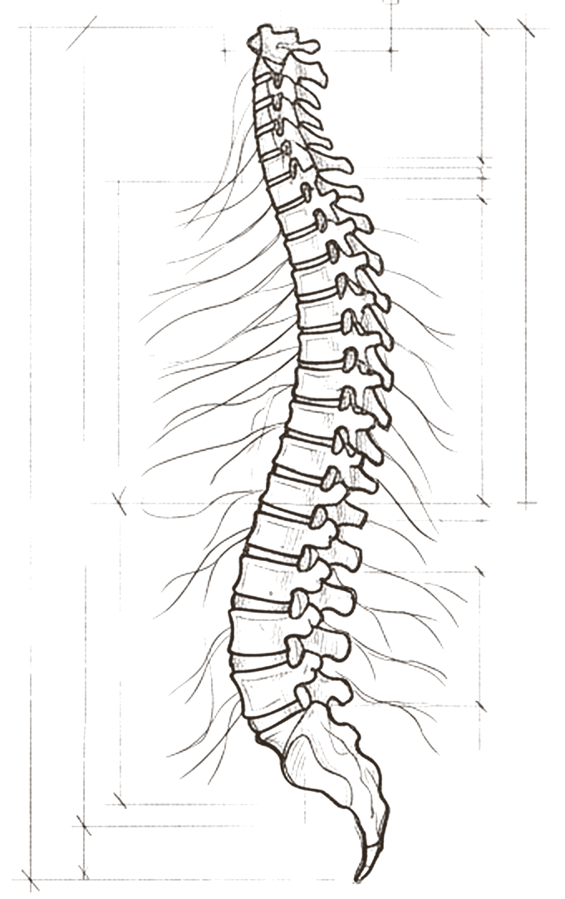
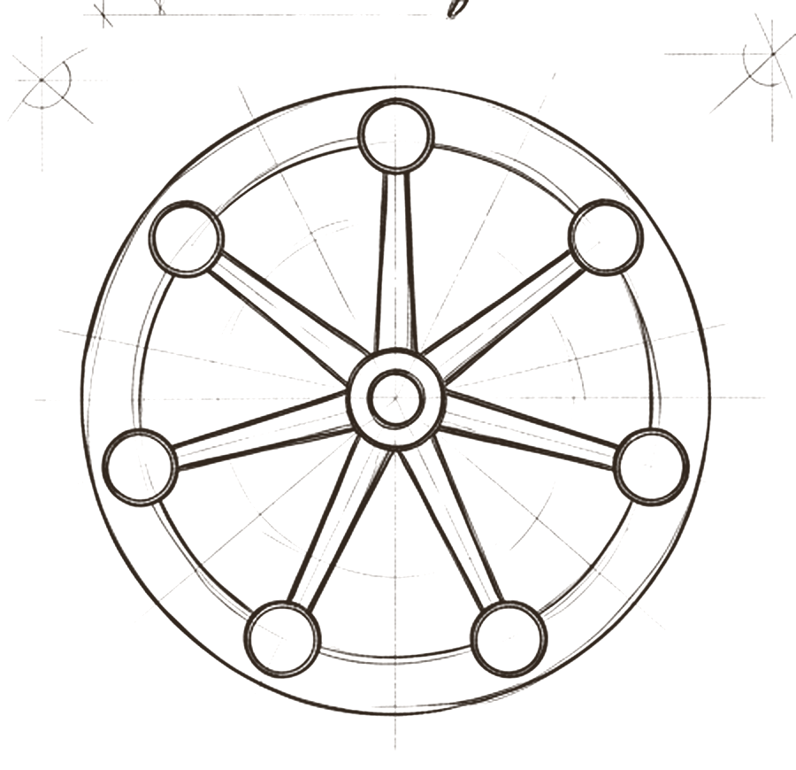
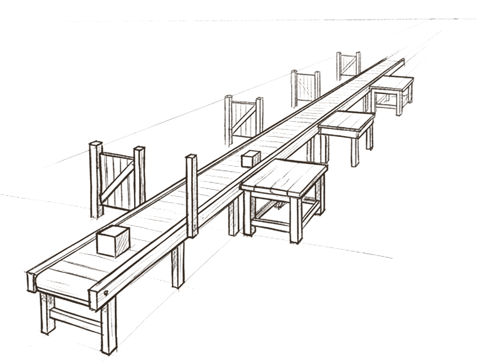
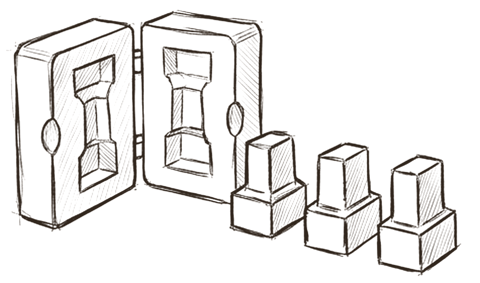

# Method

*How does the work move, step by step?*

Method is the spine of the body. It has three parts. **SOPs** are habits every agent shares: how to start a session, close one, review an artifact, handle an approval, hire an agent, run the weekly review and ingest a source. **Workflows** are production lines for one deliverable, each with a trigger, inputs, steps, a review gate, an approval gate and an output with a destination. **Templates** give every output a fixed shape.

The idea is simple: a well defined job should come out the same way twice. That is also the hardest thing to get from an AI agent, and the reason method matters more for agents than for people.

## The same steps, in the same order, every time

 <em>the backbone</em> · <strong>Predictability</strong>

Anthropic draws a useful line between *workflows*, where models and tools follow predefined paths, and *agents*, which direct their own steps. Its advice is that workflows offer predictability and consistency for well defined tasks, and agents are for when flexibility is genuinely needed [^anthropic-effective]. OWASP gives the security reason: autonomy the task does not need adds attack surface without adding value [^owasp-agentic].

Consistency is a real problem, not a theoretical one. In 2024, the best tool using agents on the τ-bench benchmark succeeded on under half of tasks, and in the retail domain all eight repeated attempts at a task succeeded less than a quarter of the time [^taubench]. Models have improved since, but the lesson holds: measure how often a job succeeds over repeated runs, and give well defined jobs a fixed backbone.

## Habits every agent shares

 <em>habits</em> · <strong>SOPs</strong>

Each spoke of the wheel is a standard operating procedure every agent follows: start a session, close a session, review an artifact, handle an approval, hire a new agent, run the weekly review and ingest a source. Because every agent opens and closes the same way, any agent can pick up where another stopped.

This mirrors what Anthropic found running long agent sessions: a fixed opening (check the working directory, read the progress notes and history, pick one item) and a fixed close (commit, update progress, leave a clean state), with one feature per session described as critical [^harness-long]. Turning procedures into explicit prompt sequences is also the core idea of MetaGPT, one of the most cited multi agent papers [^metagpt]. One detail in the model is worth copying everywhere: never pick the session to resume by latest modification time. Read the explicit session record.

## One line for one deliverable

 <em>the workflow</em> · <strong>Production line</strong>

A workflow is a production line for one kind of output, such as an audit or a content brief. It has a trigger, required inputs, numbered steps, a **review gate** where someone other than the author checks the work, an **approval gate** where a human says yes, and a named output with a destination.

This is Anthropic's prompt chaining pattern with checks between steps, plus a human checkpoint [^anthropic-effective]. What the research adds is a stopping rule. Anthropic advises stopping conditions such as a maximum number of iterations, and OpenAI names exceeding failure thresholds as one of two main triggers for handing control to a human [^anthropic-effective][^openai-guide]. Errors compound in agent systems [^anthropic-multiagent], so every workflow should carry a maximum number of attempts and a named person to escalate to.

## One mold for every output

 <em>templates</em> · <strong>Fixed shapes</strong>

Every deliverable comes from a template: the same sections, in the same order, with the same fields. Outputs become easy to compare across runs and easy to check against criteria. Handoffs between agents use templates too, which is what makes a team possible.

Anthropic found that each delegated task needs an objective, an output format, guidance on tools and sources, and clear boundaries [^anthropic-multiagent]. Its harness team kept status in JSON because the model was less likely to overwrite JSON by mistake than Markdown [^harness-long], and schema constrained output now guarantees valid structure in most cases [^structured-outputs]. So for fields that decide something (status, verdict, cost, target), use a small validated schema next to the prose.

> *an SOP is a habit every agent shares. a workflow is a line for one output*

## What research and practice say

- **Prefer a fixed workflow for well defined work.** Add agent freedom only where it pays [^anthropic-effective][^openai-guide].
- **Build steps from real procedures.** Each step one action with one output, with a branch for missing information [^openai-guide][^metagpt].
- **Check between steps, and stop on purpose.** Gates on intermediate steps, a maximum number of iterations, escalation on repeated failure [^anthropic-effective][^openai-guide].
- **Open and close every session the same way.** Read the progress record first; leave a clean, written state at the end [^harness-long].
- **Give handoffs and outputs a checkable shape.** Vague briefs cause duplicated and missed work; structured fields resist accidental overwrites [^anthropic-multiagent][^structured-outputs].
- **Context is a finite budget.** Long procedures are followed unevenly; keep a short core and load detail when needed [^context-eng][^agent-skills].

## How the model compares

> [!TIP]
> **Matches practice**
>
> - The SOP and workflow split matches OpenAI's routines and MetaGPT's SOP and assembly line framing.
> - The workflow template is prompt chaining with gates, plus a human checkpoint.
> - Session open and close SOPs mirror Anthropic's long running harness closely.
> - Templates for every deliverable match the fixed output format advice.

> [!IMPORTANT]
> **Goes further**
>
> - Review binds the exact bytes by hash; any change needs a delta review.
> - "A new role label in the same execution is not independent review."
> - Missing review stays unavailable and is never silently treated as a pass.
> - Checker defects are kept separate from artifact defects, and failed runs are kept, not rerun until they pass.

> [!WARNING]
> **Watch for**
>
> - Procedures are long for a model to follow; the key rule can get lost. A five to seven step core would help.
> - Several steps are marked script not built, and every example workflow is still unevaluated.
> - The workflow template has no maximum attempts or escalation owner.
> - No consistency test: run the same brief several times before calling a workflow reliable.

## Checklist

- [ ] For each recurring deliverable, decide: fixed workflow or agent judgment. Default to the workflow.
- [ ] Write each SOP as five to seven numbered steps with one visible output each; link the detail.
- [ ] Give every workflow a trigger, inputs, steps, review gate, approval gate, destination, maximum attempts and escalation owner.
- [ ] Open each session from the explicit record; close it with what changed, what was checked and the next action.
- [ ] Brief every handoff with objective, output format, allowed tools and sources, and boundaries.
- [ ] Keep deciding fields (status, verdict, cost) in a validated structure.
- [ ] Review against criteria frozen before the work began; missing review means not reviewed.
- [ ] Run a workflow several times on the same brief before calling it reliable.

---
Previous: [Tools](04-tools.md)  ·  Home: [The Hive Mind](README.md)  ·  Next: [Limits](06-limits.md)

[^anthropic-effective]: Erik Schluntz and Barry Zhang, "Building effective agents", Anthropic Engineering, 19 December 2024. https://www.anthropic.com/engineering/building-effective-agents ([all references](references.md#anthropic-effective))
[^owasp-agentic]: OWASP GenAI Security Project, "OWASP Top 10 for Agentic Applications for 2026", 9 December 2025. https://genai.owasp.org/resource/owasp-top-10-for-agentic-applications-for-2026/ ([all references](references.md#owasp-agentic))
[^taubench]: Shunyu Yao, Noah Shinn, Pedram Razavi and Karthik Narasimhan, "τ-bench: A Benchmark for Tool-Agent-User Interaction in Real-World Domains", arXiv 2406.12045, 17 June 2024. https://arxiv.org/abs/2406.12045 ([all references](references.md#taubench))
[^harness-long]: Justin Young, "Effective harnesses for long-running agents", Anthropic Engineering, 26 November 2025. https://www.anthropic.com/engineering/effective-harnesses-for-long-running-agents ([all references](references.md#harness-long))
[^metagpt]: Sirui Hong et al., "MetaGPT: Meta Programming for A Multi-Agent Collaborative Framework", arXiv 2308.00352. https://arxiv.org/abs/2308.00352 ([all references](references.md#metagpt))
[^openai-guide]: OpenAI, "A practical guide to building agents", PDF, April 2025 (date from file metadata). https://cdn.openai.com/business-guides-and-resources/a-practical-guide-to-building-agents.pdf ([all references](references.md#openai-guide))
[^anthropic-multiagent]: Jeremy Hadfield, Barry Zhang, Kenneth Lien, Florian Scholz, Jeremy Fox and Daniel Ford, "How we built our multi-agent research system", Anthropic Engineering, 13 June 2025. https://www.anthropic.com/engineering/multi-agent-research-system ([all references](references.md#anthropic-multiagent))
[^structured-outputs]: Anthropic, "Structured outputs", Claude Platform documentation, read 27 October 2026. https://platform.claude.com/docs/en/build-with-claude/structured-outputs ([all references](references.md#structured-outputs))
[^context-eng]: Prithvi Rajasekaran, Ethan Dixon, Carly Ryan and Jeremy Hadfield, "Effective context engineering for AI agents", Anthropic Engineering, 29 September 2025. https://www.anthropic.com/engineering/effective-context-engineering-for-ai-agents ([all references](references.md#context-eng))
[^agent-skills]: Barry Zhang, Keith Lazuka and Mahesh Murag, "Equipping agents for the real world with Agent Skills", Anthropic Engineering, 16 October 2025, updated 18 December 2025. https://www.anthropic.com/engineering/equipping-agents-for-the-real-world-with-agent-skills ([all references](references.md#agent-skills))
