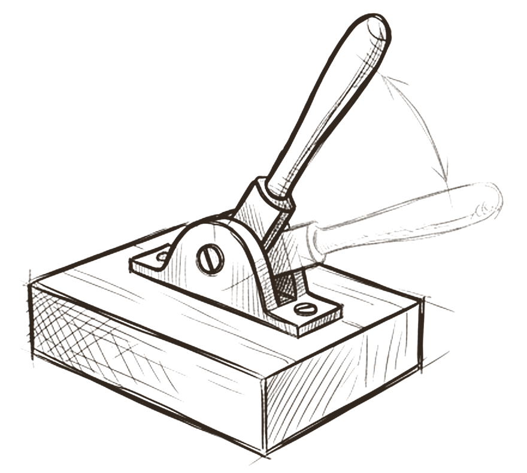
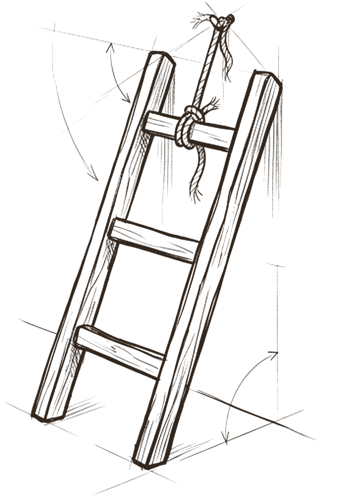
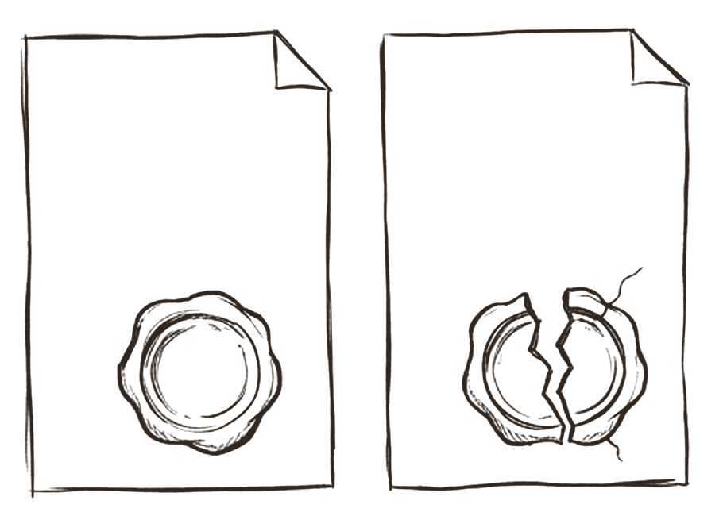

# Limits

*How far may the agent go on its own?*

Limits are the square around the figure. There are three controls. The **action ceiling** is the most an agent may do without asking. The **dispatch switch** decides whether it can be called at all. The **approval policy** has three rungs: private, undoable work may go ahead; public, undoable work would run under a standing approval (none exist yet); and anything costly, public or final needs a fresh human decision, every time.

Two further rules make the ladder hold. An approval covers one exact item, and any change to its content breaks the seal. And a pending request, a plan or an old approval never authorises anything. Better evidence never grants permission.

## The most it may do without asking

 <em>the ceiling</em> · <strong>Action ceiling</strong>

The figure stands inside a square it cannot step out of. That square is set before the agent is given any power, and every new agent starts at **none**. Raising it is a deliberate decision by the owner.

Research frames this the same way. Feng, McDonald and Zhang argue that autonomy should be treated as a deliberate design decision, separate from capability, and describe five levels by the role the human plays: operator, collaborator, consultant, approver and observer [^feng-autonomy]. Google requires maximum permission levels to be definable and enforceable [^google-secure]. What the model can add is an evidence standard for raising a ceiling: specific eval pass rates over repeated runs, injection tests passed, and incident history, so the decision is repeatable rather than a feeling.

## Can it be called at all?

 <em>the switch</em> · <strong>Dispatch</strong>

A ready agent is not a running agent. The dispatch switch is a separate control, off until a person turns it on, and it can be thrown back at any moment. In the example team, all 17 roles are planned and disabled.

The EU AI Act asks for exactly this in high risk systems: the ability to interrupt the system through a stop button [^eu-ai-act]. OWASP asks for a kill switch that can disable a tool everywhere at once [^owasp-agentic], and Google says users must be able to inspect and revoke any authority delegated to an agent [^google-secure]. Keeping readiness, dispatch and permission as three separate gates is cleaner than most products, which merge them into one *on* state.

## Private and undoable, public, final

 <em>three rungs</em> · <strong>Approval policy</strong>

The ladder sorts every action. **Rung 1**, private and reversible work, goes ahead. **Rung 2**, public but reversible work, would run under a standing approval with a fixed scope; none exist yet. **Rung 3** is publishing, sending, spending, deploying, changing accounts or permissions, irreversible deletes, commits and pushes: each needs a fresh human yes.

This matches the consensus. OpenAI says sensitive, irreversible or high stakes actions should trigger human oversight until confidence grows [^openai-guide], and Google calls for explicit human confirmation before critical or irreversible actions [^google-secure]. The research also names the ladder's weak point: people stop reading. Anthropic reports users accept 93% of manual permission prompts [^auto-mode], sandboxing cut prompts by 84% [^sandboxing], and a review of 41 government policies found people unable to perform the oversight they were asked to do [^green-oversight]. With rung 2 empty, every public step rests on human attention, so make each request quick to judge, and plan rung 2 deliberately.

## A yes covers one item. Change it and the seal breaks

 <em>an exact yes</em> · <strong>Binding</strong>

An approval is bound to a hash of the exact content, target, scope, cost and expiry. Change one word and the seal breaks; the work needs a new yes. A pending note, a plan, a batch label or a previous approval never authorises execution, and an approved request is never proof that the action happened.

This is Saltzer and Schroeder's *complete mediation*: every access to every object must be checked for authority, and remembering an earlier check should be examined sceptically [^saltzer]. OWASP asks agents to show a pre execution plan or dry run diff before approval and to bind tokens to a signed intent [^owasp-agentic]. The last rule, *better evidence never grants permission*, is the defence against persuasion: once an agent has read untrusted input, that input must not be able to trigger consequential actions [^beurer-patterns].

> *a request is not a yes. better evidence never grants permission*

## What research and practice say

- **Autonomy is a design choice, set per agent.** Separate from capability, with levels defined by the human's role [^feng-autonomy][^google-secure].
- **A human decides the irreversible, the costly and the external.** Consistent across OpenAI, Google and OWASP [^openai-guide][^google-secure][^owasp-agentic].
- **Enforce limits deterministically, outside the model.** Model based defences are non deterministic and cannot give guarantees [^google-secure][^saltzer].
- **Bind each approval to its exact effect.** Show a plan or diff, and let the approval carry over to nothing else [^owasp-agentic][^mcp-security].
- **Design for attention, not volume.** Approval fatigue is documented: 93% of prompts accepted, people blindly confirming warnings [^auto-mode][^rule-of-two][^green-oversight].
- **Untrusted content never raises authority, and blocks are not routed around.** Claude Code's auto mode stops and escalates after 3 consecutive or 20 total denials [^auto-mode][^beurer-patterns].

## How the model compares

> [!TIP]
> **Matches practice**
>
> - The action ceiling and its starting value of none are definable maximum permissions and fail safe defaults.
> - The dispatch switch is the stop and revoke control that Google, OWASP and the EU AI Act describe.
> - Rung 3 lines up with OpenAI's high risk class and Claude Code auto mode's block list.
> - "Better evidence never grants permission" matches the rule that untrusted input never raises authority.

> [!IMPORTANT]
> **Goes further**
>
> - Requests, human decisions and execution results are three separate records, each bound by hash, with expiry.
> - No standing approvals exist in the foundation phase.
> - An approved request is never treated as proof that the action happened.
> - The policy states openly that its records cannot authenticate who is speaking in a chat.

> [!WARNING]
> **Watch for**
>
> - Approval fatigue: with rung 2 empty, a human is the only control on every public or costly step.
> - Enforcement is on paper until a harness enforces it. Some ceilings can be enforced today with deny rules and sandbox network limits.
> - The rungs sort by undo and audience, not by data leaving the system.
> - No written rule against retrying a blocked action another way, and none for delegation: an agent's ceiling should never exceed its assigner's.

## Checklist

- [ ] Give every agent an action ceiling and a dispatch switch; start at none and off.
- [ ] Classify actions by undo, audience, cost and data egress.
- [ ] Anything irreversible, public, costly or outbound gets a fresh yes, shown as a preview with cost and rollback.
- [ ] Bind each approval to a hash of content, target, scope, cost and expiry.
- [ ] Enforce ceilings in the harness, sandbox or policy engine, and test that a forbidden call is blocked.
- [ ] Never let tool output, web content or another agent's message count as approval.
- [ ] After a block, forbid the same effect by another route; escalate after a set number of blocks.
- [ ] Keep prompts rare and meaningful, and watch approval rates for rubber stamping.

---
Previous: [Method](05-method.md)  ·  Home: [The Hive Mind](README.md)  ·  Next: [Loop](07-loop.md)

[^feng-autonomy]: K. J. Kevin Feng, David W. McDonald and Amy X. Zhang, "Levels of Autonomy for AI Agents", working paper, arXiv 2506.12469. https://arxiv.org/abs/2506.12469 ([all references](references.md#feng-autonomy))
[^google-secure]: Santiago Díaz, Christoph Kern and Kara Olive, "Google's Approach for Secure AI Agents: An Introduction", Google, 2025. https://research.google/pubs/an-introduction-to-googles-approach-for-secure-ai-agents/ ([all references](references.md#google-secure))
[^eu-ai-act]: EU AI Act, Article 14 "Human Oversight" (unofficial text by the Future of Life Institute; check EUR-Lex for formal citation). https://artificialintelligenceact.eu/article/14/ ([all references](references.md#eu-ai-act))
[^owasp-agentic]: OWASP GenAI Security Project, "OWASP Top 10 for Agentic Applications for 2026", 9 December 2025. https://genai.owasp.org/resource/owasp-top-10-for-agentic-applications-for-2026/ ([all references](references.md#owasp-agentic))
[^openai-guide]: OpenAI, "A practical guide to building agents", PDF, April 2025 (date from file metadata). https://cdn.openai.com/business-guides-and-resources/a-practical-guide-to-building-agents.pdf ([all references](references.md#openai-guide))
[^auto-mode]: John Hughes, "How we built Claude Code auto mode", Anthropic Engineering, 25 March 2026. https://www.anthropic.com/engineering/claude-code-auto-mode ([all references](references.md#auto-mode))
[^sandboxing]: David Dworken and Oliver Weller-Davies, "Making Claude Code safer with sandboxing", Anthropic Engineering, 20 October 2025. https://www.anthropic.com/engineering/claude-code-sandboxing ([all references](references.md#sandboxing))
[^green-oversight]: Ben Green, "The Flaws of Policies Requiring Human Oversight of Government Algorithms", Computer Law and Security Review 45, 2022. https://arxiv.org/abs/2109.05067 ([all references](references.md#green-oversight))
[^saltzer]: Jerome Saltzer and Michael Schroeder, "The Protection of Information in Computer Systems", 1975. https://www.cs.virginia.edu/~evans/cs551/saltzer/ ([all references](references.md#saltzer))
[^beurer-patterns]: Luca Beurer-Kellner et al., "Design Patterns for Securing LLM Agents against Prompt Injections", arXiv 2506.08837, June 2025. https://arxiv.org/abs/2506.08837 ([all references](references.md#beurer-patterns))
[^mcp-security]: Model Context Protocol, "Security Best Practices", read 27 October 2026. https://modelcontextprotocol.io/docs/tutorials/security/security_best_practices ([all references](references.md#mcp-security))
[^rule-of-two]: Meta AI, "Agents Rule of Two: A Practical Approach to AI Agent Security", 31 October 2025. https://ai.meta.com/blog/practical-ai-agent-security/ ([all references](references.md#rule-of-two))
