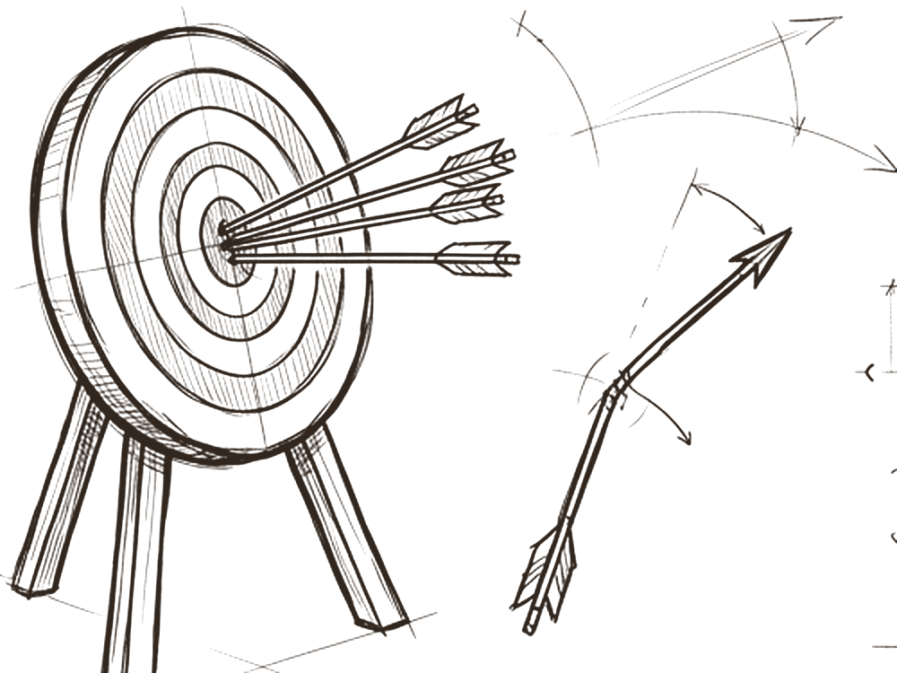
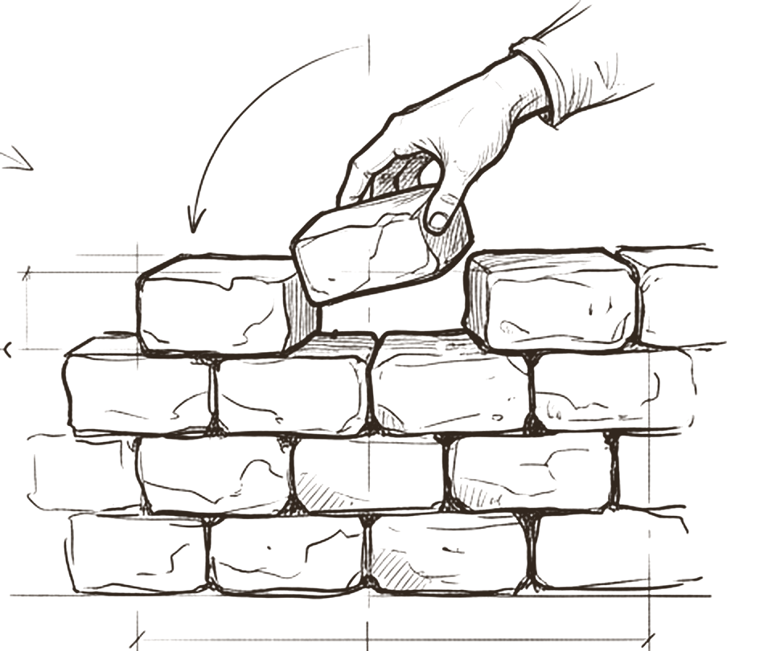

# Loop

*How is the work checked, and how does the agent get better?*

The circle around the figure is the loop. Every output comes back to be checked, and every mistake flows back in as a lesson. It has three parts: **evals**, test briefs scored on a rubric plus attack cases such as prompt injection; an **independent verifier**, because the author never approves its own work; and **learning**, where each mistake becomes a candidate lesson that, once a human accepts it, turns into a new rule, test or template.

Without the loop an agent never gets better; it only gets older. With a careless loop it can get worse, because the loop is also the one place where an agent's instructions are allowed to change.

## Every output comes back; every lesson flows in

 <em>round it goes</em> · <strong>The cycle</strong>

The water wheel turns one way: produce, check, learn, produce again. Nothing leaves the loop unchecked, and nothing learned is lost.

The research case for a learning loop is well established. Reflexion showed agents improving across trials by writing verbal reflections into an episodic memory and reading them on the next attempt [^reflexion]. But the same mechanism is a target: OWASP's agentic Top 10 lists memory and context poisoning among its risks [^owasp-agentic-summary]. Whatever writes lessons must be controlled as tightly as whatever writes rules. The model's answer is strict and, as far as the research found, unusual: lessons come only from the human's own words, are reviewed by someone other than the author, and take effect only when the human accepts them. An agent cannot write itself a new rule.

## Test briefs, a rubric, and attacks that move

 <em>an attack, caught</em> · <strong>Evals</strong>

Each agent is scored on test briefs with frozen criteria, on a 0 to 4 rubric across eight dimensions, with hard gates for anything a rule can decide. A separate set of attack cases checks that the agent resists prompt injection.

Anthropic's guidance gives the practical shape. Start with 20 to 50 tasks drawn from real failures. Write each so that two domain experts would independently reach the same pass or fail verdict, and keep a reference answer. Keep two suites: a **capability** suite that starts with a low pass rate, and a **regression** suite that must stay near 100% [^anthropic-evals]. Prefer deterministic checks; model judges need calibration against humans [^anthropic-evals][^agent-sdk] and carry known biases toward position, length and their own outputs [^zheng-judge][^panickssery]. Two gaps follow. Agents are not deterministic, so run critical tasks several times and report how many runs passed, not just whether one did. And a fixed list of attack cases tells you about yesterday's attacks: adaptive attacks bypassed 12 published defences, most with success above 90% [^nasr-attacker].

## The author never approves its own work

 <em>fresh eyes</em> · <strong>Verifier</strong>

A separate verifier checks the exact version of the work, with no access to the author's own verdict. A pass freezes that version by hash. Change it after review, and it is reviewed again.

This is the best supported rule in the whole model. Anthropic found that agents reliably skew positive when grading their own work, and that separating the agent doing the work from the agent judging it is a strong lever [^harness-design]. Models recognise and favour their own outputs [^panickssery], and self correction without outside feedback does not reliably fix reasoning [^huang-selfcorrect]. Still, a verifier is not a silver bullet: in the MAST study, verifiers often performed only superficial checks [^mast]. Test the verifier itself by planting known mistakes and counting how many it catches, and prefer a different model, or at least a fresh context, so the two roles do not share blind spots. Freezing a pass to the exact version mirrors GitHub's option to dismiss stale approvals when new commits arrive [^github-branches], applied to AI output.

## Each mistake becomes a brick in the wall

 <em>lessons</em> · <strong>Learning</strong>

When something goes wrong, the loop writes a candidate lesson. Once accepted, it becomes one of three things: a new **rule** in shared knowledge, a new **test** in the eval suite, or a change to a **template**. Each accepted lesson carries watch phrases and a re check date 90 days out.

The research suggests one tightening: every accepted lesson should also add a regression test [^anthropic-evals], so that *turn every mistake into a rule, a test or a template* reliably produces tests, and the same mistake cannot quietly return. Keep the loop light enough to use. Both Anthropic and OpenAI stress starting simple [^anthropic-effective][^openai-guide]; a loop so heavy that people skip it protects nothing. A minimum viable loop is a short test set, one independent check and a lessons file only the human can approve.

> *without the loop, an agent never gets better*

## What research and practice say

- **Build evals from real failures, in two suites.** Start with 20 to 50 tasks; separate capability from regression [^anthropic-evals].
- **Run more than once.** pass@k when one success matters, pass^k when consistency matters [^anthropic-evals][^taubench].
- **Deterministic checks first; calibrate model judges.** Judges show position, verbosity and self preference bias [^agent-sdk][^zheng-judge][^panickssery].
- **Never let the author approve its own work.** Self grading skews positive; separation is a strong lever [^harness-design][^huang-selfcorrect].
- **A verifier is necessary but not sufficient.** Superficial verification is a common multi agent failure [^mast].
- **Attack cases must adapt.** Adaptive attacks beat defences that reported near zero success on fixed tests [^nasr-attacker][^owasp-llm01].

## How the model compares

> [!TIP]
> **Matches practice**
>
> - Test briefs with frozen criteria, a rubric with hard gates and injection cases follow Anthropic's task and grader structure.
> - "The author never approves its own work" is directly supported by research.
> - Calibration guidance (held out examples, human labels, A then B and B then A ordering) matches the judge bias findings.

> [!IMPORTANT]
> **Goes further**
>
> - A pass freezes the exact bytes by hash; any change needs a delta review.
> - Four honest outcomes: pass, fail, inconclusive and not run. Inconclusive never counts as a pass.
> - Lessons come only from the human's own words, reviewed by a non author, accepted by the human, with a 90 day re check. No mainstream framework found has an equivalent.

> [!WARNING]
> **Watch for**
>
> - One run per task. Record several trials for anything the team relies on.
> - No split between capability and regression suites, and no automatic test for each accepted lesson.
> - Attack cases are a fixed list; add periodic red team rounds.
> - The verifier is never tested with planted mistakes, which the model's own notes admit.

## Checklist

- [ ] Write 20 to 50 test briefs from real failures, each with a reference answer and an unambiguous pass rule.
- [ ] Keep a capability suite and a regression suite; each fixed bug adds a regression task.
- [ ] Run critical tasks several times and report how many runs passed.
- [ ] Put deterministic checks first; calibrate any model judge against human verdicts.
- [ ] Make the verifier a different execution, ideally a different model, with a fresh context.
- [ ] Bind every pass to the exact version; any change voids it.
- [ ] Refresh attack cases with adaptive red teaming; a passed fixed list is not proof of safety.
- [ ] Only a human turns a lesson into a rule, and every accepted lesson gets a test and a re check date.

---
Previous: [Limits](06-limits.md)  ·  Home: [The Hive Mind](README.md)  ·  Next: [The hive](08-the-hive.md)

[^reflexion]: Noah Shinn et al., "Reflexion: Language Agents with Verbal Reinforcement Learning", arXiv 2303.11366, 2023. https://arxiv.org/abs/2303.11366 ([all references](references.md#reflexion))
[^owasp-agentic-summary]: Giskard, "OWASP Top 10 for Agentic Applications 2026" (secondary summary of the full list), December 2025. https://www.giskard.ai/knowledge/owasp-top-10-for-agentic-application-2026 ([all references](references.md#owasp-agentic-summary))
[^anthropic-evals]: Mikaela Grace, Jeremy Hadfield, Rodrigo Olivares and Jiri De Jonghe, "Demystifying evals for AI agents", Anthropic Engineering, 9 January 2026. https://www.anthropic.com/engineering/demystifying-evals-for-ai-agents ([all references](references.md#anthropic-evals))
[^agent-sdk]: Thariq Shihipar et al., "Building agents with the Claude Agent SDK", Claude blog, 29 September 2025. https://claude.com/blog/building-agents-with-the-claude-agent-sdk ([all references](references.md#agent-sdk))
[^zheng-judge]: Lianmin Zheng et al., "Judging LLM-as-a-Judge with MT-Bench and Chatbot Arena", NeurIPS 2023, arXiv 2306.05685. https://arxiv.org/abs/2306.05685 ([all references](references.md#zheng-judge))
[^panickssery]: Arjun Panickssery, Samuel R. Bowman and Shi Feng, "LLM Evaluators Recognize and Favor Their Own Generations", arXiv 2404.13076, 2024. https://arxiv.org/abs/2404.13076 ([all references](references.md#panickssery))
[^nasr-attacker]: Milad Nasr, Nicholas Carlini et al., "The Attacker Moves Second: Stronger Adaptive Attacks Bypass Defenses Against LLM Jailbreaks and Prompt Injections", arXiv 2510.09023, 10 October 2025. https://arxiv.org/abs/2510.09023 ([all references](references.md#nasr-attacker))
[^harness-design]: Prithvi Rajasekaran, "Harness design for long-running application development", Anthropic Engineering, 24 March 2026. https://www.anthropic.com/engineering/harness-design-long-running-apps ([all references](references.md#harness-design))
[^huang-selfcorrect]: Jie Huang et al., "Large Language Models Cannot Self-Correct Reasoning Yet", ICLR 2024, arXiv 2310.01798. https://arxiv.org/abs/2310.01798 ([all references](references.md#huang-selfcorrect))
[^mast]: Mert Cemri, Melissa Z. Pan, Shuyi Yang et al., "Why Do Multi-Agent LLM Systems Fail?", arXiv 2503.13657, v3 26 October 2025. https://arxiv.org/abs/2503.13657 ([all references](references.md#mast))
[^github-branches]: GitHub, "About protected branches", GitHub Docs. https://docs.github.com/en/repositories/configuring-branches-and-merges-in-your-repository/managing-protected-branches/about-protected-branches ([all references](references.md#github-branches))
[^anthropic-effective]: Erik Schluntz and Barry Zhang, "Building effective agents", Anthropic Engineering, 19 December 2024. https://www.anthropic.com/engineering/building-effective-agents ([all references](references.md#anthropic-effective))
[^openai-guide]: OpenAI, "A practical guide to building agents", PDF, April 2025 (date from file metadata). https://cdn.openai.com/business-guides-and-resources/a-practical-guide-to-building-agents.pdf ([all references](references.md#openai-guide))
[^taubench]: Shunyu Yao, Noah Shinn, Pedram Razavi and Karthik Narasimhan, "τ-bench: A Benchmark for Tool-Agent-User Interaction in Real-World Domains", arXiv 2406.12045, 17 June 2024. https://arxiv.org/abs/2406.12045 ([all references](references.md#taubench))
[^owasp-llm01]: OWASP GenAI Security Project, "LLM01:2025 Prompt Injection", Top 10 for LLM Applications 2025. https://genai.owasp.org/llmrisk/llm01-prompt-injection/ ([all references](references.md#owasp-llm01))
