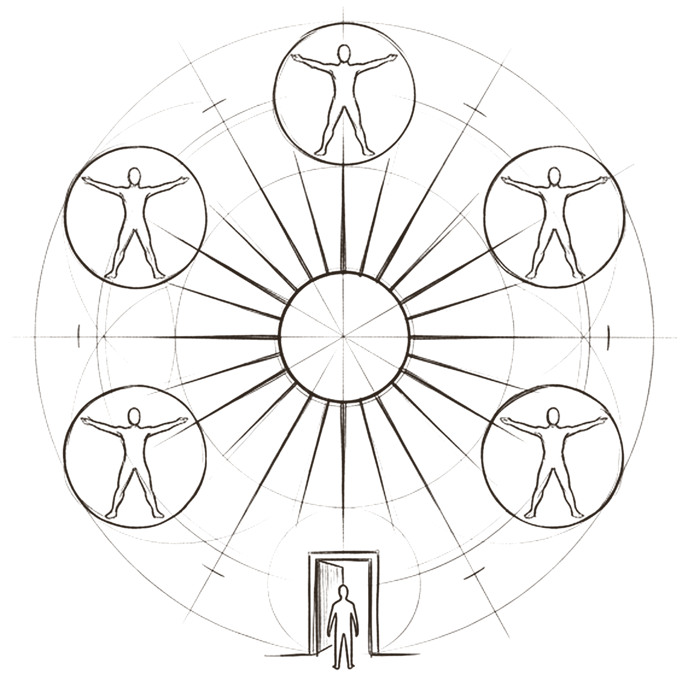
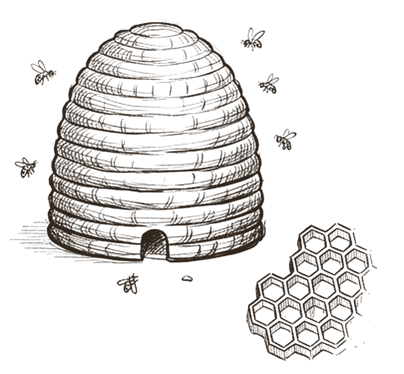
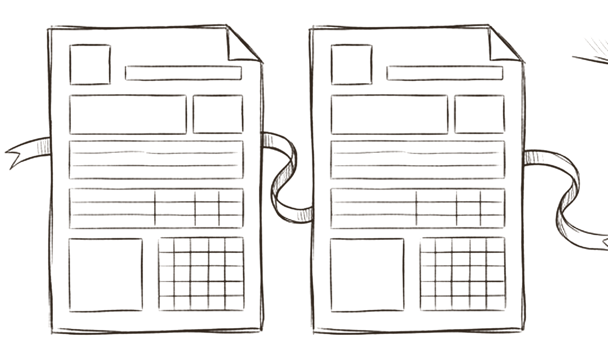
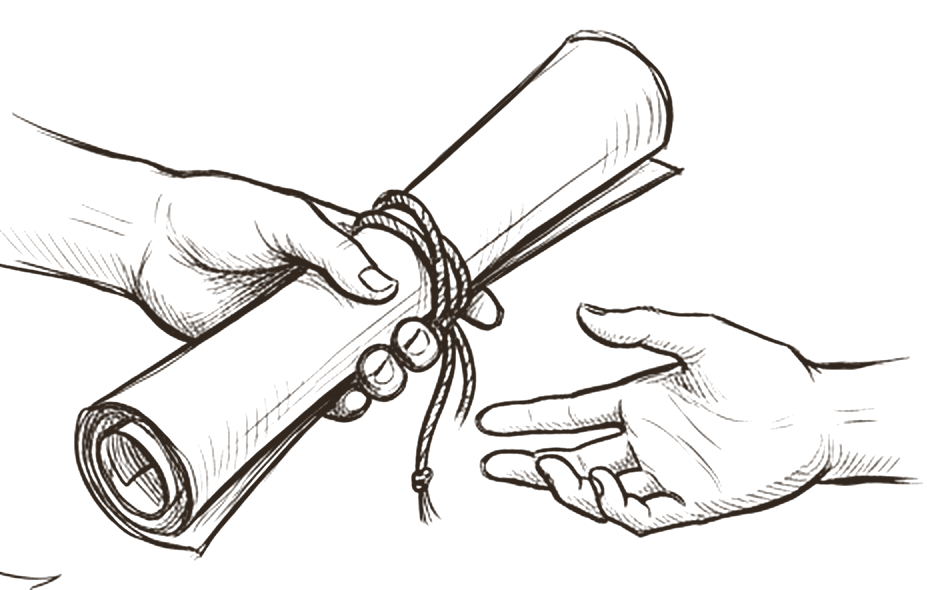

# The hive

*How do agents hand work to each other?*

Everything so far describes one agent. The hive is the team. Its shape is drawn along the bottom of the cover: **you** speak to one **front door**, which answers simple requests itself and passes production work to a **coordinator**. The coordinator picks which **specialists** do what, in what order. A **verifier** checks the work, and it comes back to **you** for a yes. Every assignment and every result uses the same form.

The order never changes: produce, have another agent review it, then present. That one rule, held across a whole team, is what lets more agents add capacity rather than confusion.

## A front door, a coordinator, and specialists

 <em>one center, one door</em> · <strong>Structure</strong>

Each circle is a whole agent with its own brains and skills. At the centre, the coordinator plans who does what. At the bottom, one door: a single agent meets you and owns the conversation. Specialists never talk to you directly.

This is OpenAI's *manager pattern*, ideal when you want one agent to control the workflow and hold access to the user [^openai-guide], with Anthropic's *orchestrator and workers* inside it, for tasks whose subtasks the coordinator decides at runtime [^anthropic-effective]. Microsoft's Magentic-One coordinator plans, tracks progress and re plans to recover from errors [^magentic]. The model routes every request one of three ways: answer it directly, send it to one specialist plus a reviewer, or coordinate a team. That matches the strongest advice in the field: start with one agent and add a team only when the work needs it [^openai-guide][^anthropic-effective]. Teams cost more (agents use about 4 times the tokens of chat, multi agent systems about 15 times) [^anthropic-multiagent], and performance gains on popular benchmarks are often minimal [^mast].

## One base prompt, shared by every role

 <em>the comb</em> · <strong>Shared base</strong>

The comb is the base prompt every agent reads before its own role: how this team works, how handoffs are shaped, what review means. Because it is shared, each agent file stays small, and a team rule changes in one place.

OpenAI recommends exactly this: a single flexible base prompt that accepts policy variables, instead of many separate prompts, because it simplifies maintenance and evaluation [^openai-guide]. Its Agents SDK also recommends a standard handoff instruction in every agent [^openai-handoffs]. The base prompt is also where the team's defaults for context belong. In the OpenAI SDK, the receiving agent sees the whole previous conversation by default [^openai-handoffs]; Claude Code teammates do not inherit the lead's history [^claude-teams]. State the default for your hive: specialists get the assignment and its frozen context, never the raw conversation.

## Every assignment and every result use the same form

 <em>one shape</em> · <strong>The contract</strong>

An **assignment** names the objective, frozen pass criteria, selected context, exact outputs, one owner, a deadline, one to three attempts and what happens on cancel. A **result** reports one state and one evidence backed verdict per criterion.

Anthropic found that without a detailed brief, agents duplicate work, leave gaps or fail to find what they need [^anthropic-multiagent]. MAST's largest failure categories include step repetition (15.7%), reasoning and action mismatch (13.2%), being unaware of when to stop (12.4%) and disobeying the task specification (11.8%) [^mast]; a tight contract targets each one. The Agent2Agent protocol makes the same move at the protocol level: tasks carry typed states, and outputs are returned as artifacts, not chat messages [^a2a]. One addition would help. A2A separates *input required* and *rejected* from failure [^a2a], and failing to ask for clarification is its own failure mode [^mast]. Adding *needs input* as a result state makes *stop and ask* a first class outcome.

## Work passes tied up, never blurred

 <em>the handoff</em> · <strong>Integrity</strong>

Work passes between agents tied up: completed, partial, blocked, failed or cancelled, and never blurred into *done*. It passes by reference, a path and a hash, not by pasting text into the next prompt. Each output path has one owner.

Passing references matches how Anthropic's research agents store work in external systems and pass lightweight references back to the coordinator [^anthropic-multiagent]. One owner per path prevents the overwrite problem Claude Code's documentation warns about, where two teammates editing the same file overwrite each other [^claude-teams]. And the model goes one step further than most frameworks: when separately passed parts are combined, the combination is a new review event, because two passed parts can still contradict each other. Two things to add: a scaling rule for the coordinator (Anthropic's early agents spawned 50 subagents for simple queries [^anthropic-multiagent]), and a frank note that a strict sequence is safer but slower, because one slow specialist can block the whole line.

> *produce, have another review it, then present: the order never changes*

## What research and practice say

- **Start with one agent; add a team only when needed.** Teams cost more and often gain little [^openai-guide][^anthropic-effective][^mast].
- **One agent owns the person.** The manager pattern keeps one agent in control of the workflow and the user [^openai-guide].
- **A coordinator plans, tracks and re plans, and scales effort to the task.** From one agent for a fact to many for deep research [^anthropic-multiagent][^magentic].
- **Every delegation needs a complete brief.** Objective, output format, tools and sources, boundaries [^anthropic-multiagent][^mast].
- **Results are typed states and artifacts, not chat.** A2A defines task states and returns outputs as artifacts [^a2a].
- **Control what crosses a handoff.** What context a receiving agent sees should be a decision, not a default [^openai-handoffs][^claude-teams].

## How the model compares

> [!TIP]
> **Matches practice**
>
> - Front door plus coordinator is the manager pattern with orchestrator and workers inside it.
> - The assignment contract is a superset of Anthropic's four brief elements; bounded attempts match OpenAI's advice to limit retries.
> - Result states closely parallel A2A's task states.
> - Paths and hashes instead of pasted text match lightweight references and artifacts.

> [!IMPORTANT]
> **Goes further**
>
> - Integration is a new review event; two passed parts can still conflict.
> - Partial or unavailable review can never be flattened into success.
> - One owner per output path prevents overwrites by design.

> [!WARNING]
> **Watch for**
>
> - No *needs input* or *rejected* result state.
> - No rule for how many specialists or attempts a task deserves.
> - The cost of strict sequencing is not discussed.
> - All roles are planned with dispatch off, so the team contract is a specification, not yet evidence of team performance.

## Checklist

- [ ] Route first: answer directly, one specialist plus a reviewer, or a coordinated team.
- [ ] Give one agent the person; specialists never talk to the person unless handed over.
- [ ] Use one assignment form: objective, criteria, frozen context, outputs, owner, deadline, attempts, cancel rule.
- [ ] Use one result form with a closed list of states, including *needs input*.
- [ ] Pass work by path and hash, never by pasting it into the next prompt.
- [ ] Write a scaling rule: how many specialists and attempts for small, medium and large tasks.
- [ ] Keep the shared base prompt in one file and include it in every role.
- [ ] Hold the order: produce, review, integrate, review the whole, then present.

---
Previous: [Loop](07-loop.md)  ·  Home: [The Hive Mind](README.md)  ·  Next: [The nervous system](09-the-nervous-system.md)

[^openai-guide]: OpenAI, "A practical guide to building agents", PDF, April 2025 (date from file metadata). https://cdn.openai.com/business-guides-and-resources/a-practical-guide-to-building-agents.pdf ([all references](references.md#openai-guide))
[^anthropic-effective]: Erik Schluntz and Barry Zhang, "Building effective agents", Anthropic Engineering, 19 December 2024. https://www.anthropic.com/engineering/building-effective-agents ([all references](references.md#anthropic-effective))
[^magentic]: Adam Fourney et al., "Magentic-One: A Generalist Multi-Agent System for Solving Complex Tasks", Microsoft Research, arXiv 2411.04468, 2024. https://arxiv.org/abs/2411.04468 ([all references](references.md#magentic))
[^anthropic-multiagent]: Jeremy Hadfield, Barry Zhang, Kenneth Lien, Florian Scholz, Jeremy Fox and Daniel Ford, "How we built our multi-agent research system", Anthropic Engineering, 13 June 2025. https://www.anthropic.com/engineering/multi-agent-research-system ([all references](references.md#anthropic-multiagent))
[^mast]: Mert Cemri, Melissa Z. Pan, Shuyi Yang et al., "Why Do Multi-Agent LLM Systems Fail?", arXiv 2503.13657, v3 26 October 2025. https://arxiv.org/abs/2503.13657 ([all references](references.md#mast))
[^openai-handoffs]: OpenAI, "Handoffs", OpenAI Agents SDK documentation. https://openai.github.io/openai-agents-python/handoffs/ ([all references](references.md#openai-handoffs))
[^claude-teams]: Anthropic, "Orchestrate teams of Claude Code sessions" (agent teams, experimental), Claude Code documentation, read 27 October 2026. https://code.claude.com/docs/en/agent-teams ([all references](references.md#claude-teams))
[^a2a]: A2A Project, "Agent2Agent (A2A) Protocol Specification", version 1.0.0. https://a2a-protocol.org/latest/specification/ ([all references](references.md#a2a))
