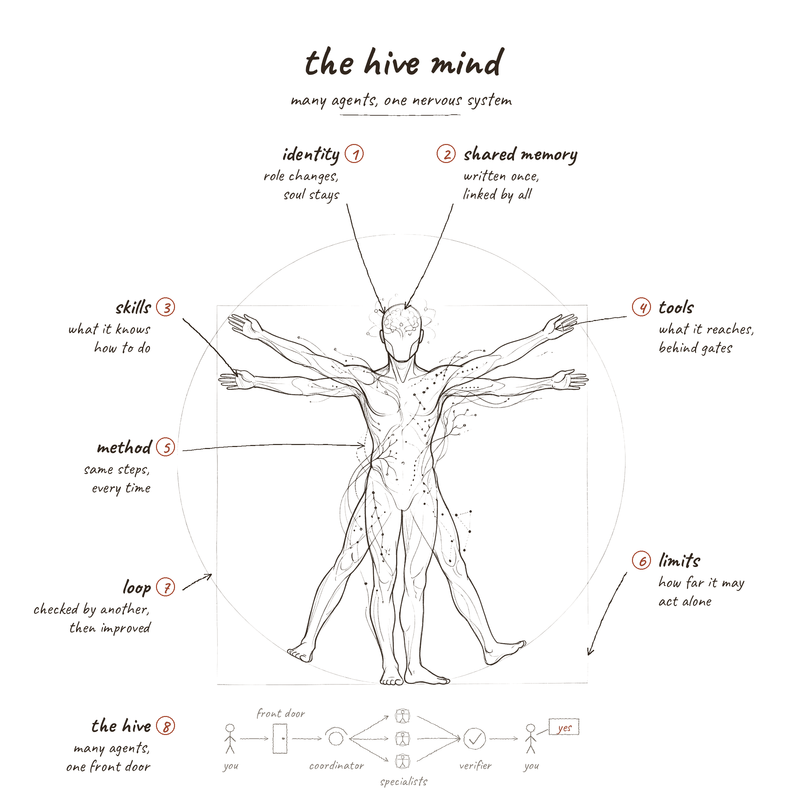

# The Hive Mind

*How to design AI agents that work as one: the layers of a single agent, the team around it, and the nervous system that joins them.*

## One body, many minds

*Why build an agent in layers, and why build agents as a team?*

Most AI agents start life as one long prompt. It works for a week. Then a rule gets added for one client, another for a new tool, a third after a bad output, and soon nobody can say which instruction lives where, which ones contradict each other, or why the agent did what it did. The prompt has become a junk drawer.

This guide describes a different way to build: an agent is a small file that says who it is and links to the parts it uses. Everything the whole team shares is written once, in one place, and every agent points to it instead of keeping its own copy. The parts are grouped into layers, and each layer answers one question. When there is more than one agent, a team layer decides how they hand work to each other, and a proposed nervous system lets the team sense itself as one body.

The drawing on the cover is the map. The figure is one agent: its head holds identity and memory, its hands hold skills and tools, its spine carries method, the square marks its limits and the circle its loop. The strip along the bottom is the hive: you, a front door, a coordinator, specialists, a verifier, and you again at the end.

## The parts

| Part | Question it answers | Belongs to |
|---|---|---|
| [Identity](01-identity.md) | Who is this agent, and what is its job? | The agent |
| [Shared memory](02-shared-memory.md) | What does it know, and how does it read it? | Own expertise, plus shared rules |
| [Skills](03-skills.md) | What does it know how to do? | The agent |
| [Tools](04-tools.md) | What can it reach, and what stops it? | The agent, under shared policy |
| [Method](05-method.md) | How does the work move, step by step? | The team |
| [Limits](06-limits.md) | How far may it go on its own? | Set per agent, policy shared |
| [Loop](07-loop.md) | How is its work checked and improved? | The team |
| [The hive](08-the-hive.md) | How do agents hand work to each other? | The team |
| [The nervous system](09-the-nervous-system.md) | How does the team feel itself as one body? | The team (proposed) |

Prefer a picture? Open [the study sheets](../drawings/).

**How to read the chapters.** Each chapter takes one part of the body. It opens with the idea in plain words, then walks through the studies drawn for it, one element at a time. After that comes what published research and practice say, an honest comparison with this model (where it matches, where it goes further, and what to watch for), and a checklist you can apply to your own agents.

**About the evidence.** The research was gathered in October 2026 from primary sources: engineering writing and documentation from Anthropic, OpenAI, Google, Meta and Microsoft, security guidance from OWASP and NIST, and peer reviewed papers and preprints. Numbers describe the settings of the study they come from, not every agent system. Numbered references are listed at the end. Where this guide says "the model", it means the agent layers model and its example files, built for a 17 agent marketing team. Take the ideas, not the wording.

## Ten principles

1. Link, don't copy. Each fact lives in one place.
2. Separate who an agent is from what it does.
3. Keep agent files small. Push shared rules down into the team layer.
4. Give each agent its own expertise and shared rules from one source.
5. Write procedures down once and reuse them.
6. Give every input and output a template.
7. Set limits before adding power.
8. Check work with someone other than the author.
9. Turn every mistake into a rule, a test or a template change.
10. Keep readiness separate: a task can be ready, an agent can be ready, and permission to run is a third, separate gate.

> *one thread runs through every chapter: written rules guide an agent, but only enforcement controls it*

## Keep going

- Start with [Identity](01-identity.md)
- Finish with [Putting it together](10-putting-it-together.md)
- Every source: [References](references.md)
